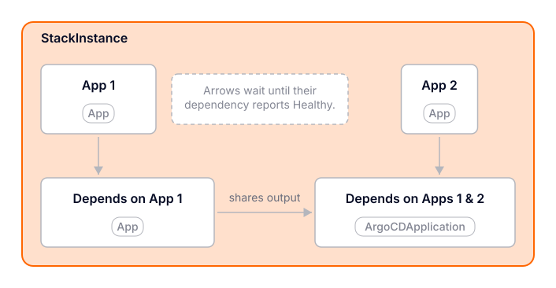

# vCluster Stacks

Stacks deploy Apps and Argo CD Applications as one unit, with dependency ordering,
health gates, shared parameters, and values passed between tasks. This repository
contains reusable integrations for vCluster Platform's native Stacks API,
introduced in Platform 4.12.

  

## Available integrations

**Certified Stacks** are reviewed and tested integrations accepted by vCluster
Labs. Platform releases bundle a pinned set of their templates and supporting
resources. The files on this repository's `main` branch can differ from your
installed Platform release.

| Integration | Deployment models | Components |
| --- | --- | --- |
| [NVIDIA Run:ai](certified-stacks/run-ai/) | Dedicated or central control plane | Run:ai and supporting GPU infrastructure |
| [NVIDIA Dynamo](certified-stacks/nvidia-dynamo/) | One runtime per cluster or control plane cluster | Dynamo operator, NATS, and etcd |
| [Saturn Cloud Enterprise](certified-stacks/saturn/) | One installation per cluster or control plane cluster | Saturn Cloud Helm operator and Enterprise components |
| [NVIDIA NVKE management plane](certified-stacks/nvidia-nvke-mgmt/) | One installation per cluster, from an NVKR release | Release verification and NVKE management services |

**Community Stacks** are contributions from community members, partners, and
vCluster Labs. They are installed manually and do not carry formal vCluster
Product & Engineering support. Acceptance into this repository does not make a
Stack Certified or automatically add it to your Platform installation.

| Integration | Purpose |
| --- | --- |
| [OpenClaw](community-stacks/openclaw/) | Agent gateway with a local or external model backend |
| [NVIDIA GPU Operator](community-stacks/nvidia-gpu-operator/) | GPU Operator and NVSentinel with readiness gates and a GPU smoke test |
| [Metered inference](community-stacks/metered-inference/) | Inference gateway, model serving, token metering, and showback |

Check each integration's README for requirements, tested configurations,
limitations, and installation instructions. Report repository problems through
[GitHub issues](https://github.com/loft-sh/vcluster-stacks/issues), following any
integration-specific reporting instructions. Do not include sensitive values.

The earlier Terraform implementations are on the
[`certified-stacks-legacy`](https://github.com/loft-sh/vcluster-stacks/tree/certified-stacks-legacy)
branch.

## Use a stack

For Certified Stacks, start with the templates bundled with your Platform release.
Use the [Platform Stacks documentation](https://www.vcluster.com/docs/platform/understand/what-are-stacks)
and the integration's README to understand prerequisites and deployment models.
Bundled resources can change during a Platform upgrade. To customize a Certified
StackTemplate, copy it under a new name and remove its `vcluster.com/certified`
annotation. Review referenced Apps too: copying a StackTemplate does not copy its
dependencies.

For Community Stacks, follow the integration's installation instructions. Connect
`kubectl` to the Platform management API, apply its Apps or
ArgoCDApplicationTemplates and supporting resources in the documented order, then
create the StackTemplate and a configured StackInstance. Applying only the
StackTemplate is insufficient when it references resources you have not installed.

Use a non-production environment to evaluate a Stack before using it with live
workloads. Check destination permissions, shared components, and removal behavior.

## Build a stack

A `StackTemplate` defines the tasks and their dependencies. A project-scoped
`StackInstance` selects a destination and supplies parameter values. Tasks can use
inline App or Argo CD Application templates, or reference reusable templates.

Start with the working [starter folder](templates/stack/). It uses two ConfigMaps
to demonstrate parameters, health-gated dependencies, and output handoff. The
single-file [starter example](examples/starter-stack.yaml) contains the same
resources and is checked against that folder.

For the API and lifecycle rules, see:

- [Create a Stack template](https://www.vcluster.com/docs/platform/administer/templates/create-stack-templates)
- [StackTemplate reference](https://www.vcluster.com/docs/platform/api/resources/stacktemplate)
- [StackInstance reference](https://www.vcluster.com/docs/platform/api/resources/stackinstance)
- [Troubleshoot Stacks](https://www.vcluster.com/docs/platform/troubleshoot/stacks)

## Contribute a stack

Read [CONTRIBUTING.md](CONTRIBUTING.md) for the contribution standard, validation
commands, test evidence, and review process. Copy the [starter folder](templates/stack/)
and adapt the [README outline](templates/README-template.md) to your integration.
New integrations normally go under `community-stacks/<integration>/`.

Choose an example that matches your integration's needs:

- [NVIDIA Dynamo](certified-stacks/nvidia-dynamo/) shows a small Stack with an inline App.
- [NVIDIA GPU Operator](community-stacks/nvidia-gpu-operator/) combines App and Argo CD tasks.
- [Metered inference](community-stacks/metered-inference/) coordinates several related Stacks.
- [Run:ai](certified-stacks/run-ai/CONTRIBUTING.md) documents shared source and generated deployment variants.

## License

[Apache License 2.0](LICENSE).
