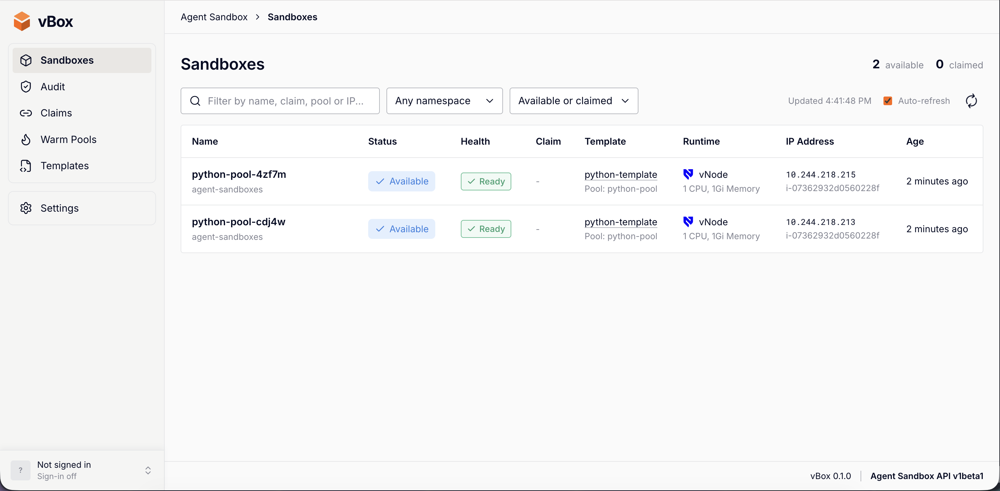

# Agent Sandboxes - Secure and isolated sandboxes for your AI Agents

AI agents write and run code nobody has reviewed: generated Python, shell commands,
a browser following whatever links it finds. Run that next to your other workloads
and one bad or hijacked step can read their secrets, reach internal services or the
cloud metadata endpoint, or take down the node. Agents need a sandbox: a short-lived,
isolated place to run code that can be thrown away afterwards.

This project provides those sandboxes with vCluster. Each team or agent fleet gets
its own tenant cluster with private EC2 nodes, created from a template in the
vCluster Platform UI. Inside it, the
[Kubernetes Agent Sandbox](https://agent-sandbox.sigs.k8s.io) hands out sandboxes on
demand, each one running under vNode and fenced in by policy.



**What you get**

- **Sandboxes in seconds.** A warm pool keeps pre-started sandboxes ready, so an agent
  claiming one adopts a running pod instead of waiting for a cold start. Two official
  sandbox types are installed: a Python runtime and Chromium.
- **Isolation in layers.** Every sandbox runs under vNode in its own user namespace, so
  root inside it is an unprivileged user on the node. An admission policy rejects any
  sandbox that is not on vNode or not hardened (non-root, all capabilities dropped,
  no host access, resource limits set). A NetworkPolicy admits traffic only from the
  Sandbox Router and allows public egress only, with private ranges and the cloud
  metadata endpoint blocked, or no egress at all.
- **Capacity that follows demand.** Sandbox nodes are autoscaled EC2 instances in the
  AWS region you pick, added for pending sandboxes and removed once empty. System
  components stay on one always-on base node, so sandbox nodes really do empty out.
- **Visibility.** vBox, pictured above, shows every sandbox, claim, warm pool and
  template, the runtime each sandbox runs on, and an audit trail of which client used
  which sandbox.

**How it fits together**

1. A **NodeProvider** lets the platform create EC2 nodes with Terraform.
2. A **tenant cluster template** (`Agent Sandbox on AWS (Auto Nodes)`) creates a tenant
   cluster with private nodes in the chosen region: one base node plus an autoscaled
   sandbox pool.
3. The **Stack**, declared by the template, installs everything inside that cluster
   as soon as it is up, in dependency order, and verifies the result. See [What the Stack does](#what-the-stack-does).
4. **Agents** claim sandboxes with the Agent Sandbox SDK, using the namespace and warm
   pool the Stack publishes as outputs:

   ```python
   from k8s_agent_sandbox import SandboxClient
   from k8s_agent_sandbox.models import SandboxLocalTunnelConnectionConfig

   client = SandboxClient(connection_config=SandboxLocalTunnelConnectionConfig())
   sandbox = client.create_sandbox(warmpool="python-pool", namespace="agent-sandboxes")
   try:
       print(sandbox.commands.run("python3 -c 'print(6 * 7)'").stdout)
   finally:
       sandbox.terminate()   # releases the claim; the warm pool refills
   ```

   [`data-analytics-agent/agent.py`](data-analytics-agent/agent.py) is a complete
   example: a LangChain agent on Amazon Bedrock that analyzes a spreadsheet with
   pandas inside a sandbox. It brings no model of its own; set `BEDROCK_MODEL_ID` to
   a Bedrock model or inference profile that supports tool use:

   ```bash
   cd data-analytics-agent
   uv sync                                   # Python 3.11+, deps from uv.lock
   export AWS_PROFILE=<profile> KUBECONFIG=<tenant-cluster-kubeconfig>
   export BEDROCK_MODEL_ID=<model-or-inference-profile-id>
   uv run python agent.py data.xlsx "Which region had the highest revenue?"
   ```

   `data.xlsx` is a sample sales workbook to ask questions about. See
   [Smoke test](#smoke-test) for running several agents at once.

5. **vBox** shows what the agents are doing. It is a web UI, installed by the Stack,
   that lists every sandbox object in the tenant cluster: sandboxes, claims, warm
   pools and templates, with the runtime each sandbox runs on and an audit trail of
   which client used which sandbox. The Stack publishes its address as the
   `vboxAddress` output.

**What's in this folder**

| Path | What |
| --- | --- |
| `manifests/amazon-ec2-nodeprovider.yaml` | NodeProvider `aws-ec2`: EC2 private nodes through Terraform |
| `manifests/agent-sandbox-template.yaml` | VirtualClusterTemplate `agent-sandbox-aws`: the tenant cluster, its node pools and parameters |
| `manifests/agent-sandbox-stack-template.yaml` | StackTemplate `agent-sandbox`: everything installed inside the tenant cluster |
| `data-analytics-agent/agent.py` | Example agent that claims a Python sandbox and analyzes a spreadsheet in it |
| `data-analytics-agent/run_agents.py` | Smoke test: runs several agents at once against the warm pool |
| `data-analytics-agent/data.xlsx` | Sample sales workbook the agents analyze |
| `data-analytics-agent/pyproject.toml`, `uv.lock` | The agents' Python project, for `uv sync` |
| `vbox/vbox-ui/` | Source of vBox (Next.js app, Dockerfile) |
| `chart/` | vBox's Helm chart |
| `docs/` | Images for this README |

## What the Stack does

The `agent-sandbox` Stack turns a fresh tenant cluster with private nodes into a
place where AI agents run untrusted code safely. An agent asks for a sandbox, gets an
isolated pod from a pool of pre-started ones within seconds, runs its code in it,
and releases it when done. Every sandbox runs in its own user namespace under vNode,
so a container escape lands in the vNode rather than on the node, and it is fenced in
by admission policy, NetworkPolicy and quotas.

It installs, in dependency order:

| Component | Why it is needed |
| --- | --- |
| **Calico** | The CNI. Replaces Flannel because sandbox isolation relies on NetworkPolicy, which Flannel does not enforce. |
| **vNode** | The sandbox runtime (RuntimeClass `vnode`). Gives each sandbox its own user namespace and UID range, so root in a sandbox is not root on the node. |
| **Agent Sandbox controller** | The upstream Kubernetes Agent Sandbox controller and its CRDs: `Sandbox`, `SandboxTemplate`, `SandboxWarmPool`, `SandboxClaim`. |
| **Sandbox Router** | The data-plane proxy agents reach sandboxes through. Only the agent namespace may call it. |
| **Guardrails** | A ValidatingAdmissionPolicy that rejects any sandbox not on vNode or not hardened, plus a quota, limits and claim-only RBAC for the agent service account. |
| **Sandbox templates and warm pool** | Two official sandboxes, a Python runtime (port 8888) and Chrome with the DevTools Protocol (port 9222), and a warm pool that keeps one of them ready. |
| **vBox** | A web UI for sandboxes, claims, warm pools and templates, with an audit trail of which client used which sandbox. |

Around these, a few short-lived jobs make the install reliable rather than adding
anything that keeps running: they allow host networking for Calico and vNode under
the AWS node provider's admission policy, wait for Calico and vNode to be ready, check
the nodes' kernel and container runtime, and verify at the end that sandboxes really
run under vNode and that the admission policy rejects a privileged one. Deleting the
Stack runs a teardown that removes vBox, the controller and vNode in a safe order.
Calico stays, because it is the cluster's network; it goes with the cluster.

The Stack publishes `sandboxNamespace`, `warmPoolName`, `vboxAddress`,
`routerClusterIP` and `warmPoolReady` as outputs, which is what an agent needs to
claim a sandbox and what a person needs to open vBox.

## How vBox works

vBox is a single Next.js server (App Router, TypeScript) running as one pod in its
own `vbox-system` namespace inside the tenant cluster. It has no database server
and no agent of its own: everything it shows comes from the tenant cluster's API
server, and the little it stores lives in SQLite files on a PersistentVolumeClaim.

```
                      tenant cluster API server
                 ▲              ▲               ▲
  get/list       │              │ pods/log      │ list/update
  Sandbox,       │              │ (follow)      │ settings Secret
  Claim, Pool,   │              │               │
  Template, Pods │              │               │
┌────────────────┴──┐ ┌─────────┴──────────┐ ┌──┴───────────────────┐
│ Pages             │ │ Audit collector    │ │ Sign-in (optional)   │
│ server-rendered,  │ │ polls claims 3 s,  │ │ OIDC code flow +     │
│ read on every     │ │ follows Sandbox    │ │ PKCE, server-side    │
│ request, 5 s auto │ │ Router access log  │ │ sessions             │
│ refresh           │ │                    │ │                      │
└───────────────────┘ └─────────┬──────────┘ └──┬───────────────────┘
                                ▼               ▼
                       /data/audit.db      /data/auth.db   (PVC)
```

It has three parts, all in the same process:

- **Pages.** Sandboxes, Claims, Warm Pools and Templates are rendered on the server
  from a fresh read of the four Agent Sandbox kinds plus their pods, PVCs and
  NetworkPolicies. Nothing is cached between requests, so a page always shows what
  the API server holds. The service account's ClusterRole is `get`/`list` only, with
  no `watch` and no writes.
- **Audit collector.** Started with the server (`src/instrumentation.ts`), it turns
  two sources into one session per claimed sandbox: `SandboxClaim` transitions,
  polled every 3 seconds (created, assigned warm or cold, ready, released, with the
  client from the `agents.x-k8s.io/created-by` label), and the Sandbox Router's
  access log, followed live, where every client request becomes a step. It reads
  only the router's logs, never the sandbox pods' own logs or request payloads.
  Events go into `audit.db`, which is append-only (triggers reject `UPDATE` and
  `DELETE`) and hash-chained, so tampering shows up as a broken chain on the
  session timeline. Saved read positions and per-event dedup keys let a restarted
  collector resume without gaps or duplicates.
- **Sign-in.** Off until an OpenID Connect provider is configured on the Settings
  page. The provider settings live in a Secret in `vbox-system` that vBox finds by
  the `vbox.vcluster.com/oidc-config: "true"` annotation, which is the one object
  vBox writes. Sessions live in `auth.db`, kept apart from the audit trail because
  they are mutable. `src/proxy.ts` turns away unauthenticated requests, and pages
  and routes check the session again where the data is used.

Because a single collector owns `audit.db`, vBox runs as one replica. The source is
in [`vbox/vbox-ui/`](vbox/vbox-ui/), and its README covers the pages, the audit
trail and sign-in in detail.

## Where it runs

The sandbox stack is not tied to a cloud. The Stack installs onto any tenant cluster
whose nodes meet vNode's requirements (below), wherever those nodes come from: a
public cloud, bare metal or VMs. Only two files are AWS-specific:
`manifests/amazon-ec2-nodeprovider.yaml` and
`manifests/agent-sandbox-template.yaml`, which create the tenant cluster's nodes on
EC2. To run somewhere else, replace them with a NodeProvider and a template for
your infrastructure and keep the StackTemplate as it is.

It has been tested on AWS, with tenant clusters on EC2 private nodes created by
the files in this folder.

## How-to

### Prerequisites

- vCluster Platform, with a license that includes vNode.
- Nodes that meet the
  [vNode requirements](https://www.vnode.com/docs/installation/requirements):

  | Requirement | Minimum | How to verify |
  | --- | --- | --- |
  | Linux kernel | 6.1+ (6.3+ recommended for full id-mapped tmpfs support) | `uname -r` |
  | cgroup | v2 (v1 is not supported) | `stat -fc %T /sys/fs/cgroup/` returns `cgroup2fs` |
  | containerd | 1.7 or 2.0 | `containerd --version` |
  | Kubernetes | 1.24+ | `kubectl version` |

  `cri-dockerd` (Docker Desktop, OrbStack) and `cri-o` (OpenShift) are not
  supported. On managed Kubernetes: EKS needs the `AmazonLinux2023` AMI family
  (not Auto Mode, not Bottlerocket), GKE is supported except Autopilot, and AKS
  needs Kubernetes 1.32.0+ with `--os-sku AzureLinux`.

  The Stack's preflight job stops the install if a node runs a kernel older than
  6.1 or a runtime other than containerd, and warns on a containerd version outside
  1.7 or 2.0. It does not check the cgroup version.

### 1. Build and publish vBox

The Stack installs vBox from a Helm chart in an OCI registry, and the chart runs an
image from the same registry. Neither is published for you: `<your-registry>` is a
placeholder in `chart/values.yaml` (`image.repository`) and in
`manifests/agent-sandbox-stack-template.yaml` (the `vboxChart` default). Do this once, and
again for every new vBox version, before applying the templates.

**The registry must allow anonymous pulls.** The Stack's install job pulls the chart
without logging in, and the tenant cluster's nodes pull the image without a pull
secret. Any OCI registry works: GitHub Container Registry, Docker Hub, ECR Public,
Harbor and so on. GitHub creates new packages as private; make both public after the
first push.

Run everything from this directory. You need Docker with buildx, Helm 3.8+ and
`kubectl`.

```bash
# Where both go: a registry host plus a namespace, no scheme, no trailing slash.
export REGISTRY=ghcr.io/your-org            # or docker.io/you, public.ecr.aws/<alias>, ...
VERSION=$(awk '/^appVersion:/ {gsub(/"/, "", $2); print $2}' chart/Chart.yaml)   # image tag
CHART_VERSION=$(awk '/^version:/ {print $2}' chart/Chart.yaml)                    # chart version

# 1. Log in to the registry (the host part of $REGISTRY).
docker login "${REGISTRY%%/*}"
helm registry login "${REGISTRY%%/*}"

# 2. Build and push the image. The tenant clusters' EC2 nodes are amd64; on an arm64
#    Mac this cross-builds.
docker buildx build --platform linux/amd64 \
  -t "$REGISTRY/vbox-ui:$VERSION" --push vbox/vbox-ui

# 3. Point the chart and the StackTemplate at the registry.
sed -i.bak "s#<your-registry>#$REGISTRY#g" chart/values.yaml manifests/agent-sandbox-stack-template.yaml
rm chart/values.yaml.bak manifests/agent-sandbox-stack-template.yaml.bak

# 4. Check the chart now renders your image.
helm template vbox chart -n default | grep 'image:'
#   image: "ghcr.io/your-org/vbox-ui:0.1.0"

# 5. Package and push the chart. It is pushed as $REGISTRY/vbox.
helm package chart
helm push "vbox-$CHART_VERSION.tgz" "oci://$REGISTRY"
rm "vbox-$CHART_VERSION.tgz"
```

The image tag is the chart's `appVersion`, so the chart and the image it runs always
match; `image.tag` in `chart/values.yaml` overrides that.

**Releasing a new vBox version:** bump `version` and `appVersion` in
`chart/Chart.yaml`, repeat steps 2, 4 and 5 (step 3 only needs doing once), then
update the StackTemplate's `vboxVersion` default to the new chart `version`, or set
`vboxVersion` on the Stack.

`vbox/vbox-ui/scripts/install.sh` is a separate developer shortcut: it builds the
image, pushes it to a private ECR repository in your AWS account and installs the
chart straight into the cluster of your current kube context, with an ECR token as a
pull secret. The Stack does not use it.

### 2. Apply the platform objects

```bash
vcluster platform connect management
kubectl apply -f manifests/amazon-ec2-nodeprovider.yaml        # NodeProvider "aws-ec2"
kubectl apply -f manifests/agent-sandbox-stack-template.yaml   # StackTemplate "agent-sandbox"
kubectl apply -f manifests/agent-sandbox-template.yaml         # VirtualClusterTemplate "agent-sandbox-aws"
```

To update one later, use `kubectl replace -f <file>` instead: the platform merges list
fields (`spec.parameters`, `spec.tasks`) by position, so an apply after reordering
entries leaves stale fields behind.

Then create a tenant cluster from **Agent Sandbox on AWS (Auto Nodes)**. The template
declares the **Agent Sandbox** Stack in its `deploy.stacks`, so it installs on its
own once the cluster is up, with the warm sandbox type, warm pool size, sandbox
egress and vBox service type you picked. Because the template declares it, the
platform recreates the Stack if you delete it from the cluster; to remove everything,
delete the tenant cluster.

### Smoke test

`data-analytics-agent/run_agents.py` checks the whole path end to end: it starts
several copies of `agent.py` at once, each of which claims its own Python sandbox
from the warm pool, port-forwards to the Sandbox Router, analyzes `data.xlsx` with a
Bedrock model and releases the claim. Each sandbox is held for a minimum lifetime,
so the claims overlap and the warm pool has to refill while they are still in use.

You need [uv](https://docs.astral.sh/uv/), `kubectl` on `PATH`, AWS credentials with
access to a Bedrock model that supports tool use, and a kubeconfig for the tenant
cluster that may create `SandboxClaim`s in `agent-sandboxes` and port-forward to the
router.

```bash
cd data-analytics-agent
uv sync
export AWS_PROFILE=<profile> AWS_REGION=eu-central-1
export KUBECONFIG=<tenant-cluster-kubeconfig>
export BEDROCK_MODEL_ID=<model-or-inference-profile-id>

uv run python run_agents.py                                         # 4 agents, 30 s minimum per sandbox
uv run python run_agents.py --agents 6 --min-lifetime 60 --stagger 2
```

| Option | Default | Meaning |
| --- | --- | --- |
| `--agents` | 4 | Agents started at once, each with a different question |
| `--min-lifetime` | 30 | Seconds each sandbox is kept after it is ready |
| `--stagger` | 0 | Seconds between agent starts |
| `--xlsx` | `data.xlsx` | Spreadsheet the agents analyze |

Every agent's output is prefixed with its name (`agent-1`, `agent-2`, ...). At the
end a table lists each agent's exit code, how long its sandbox was alive and its
claim. The script exits non-zero if any agent failed, never got a sandbox, or
released it before the minimum lifetime. Each agent labels its claim with
`agents.x-k8s.io/created-by: agent-<n>`, so the runs show up as separate clients on
vBox's **Audit** page.
