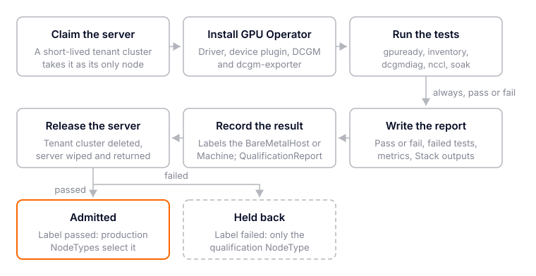
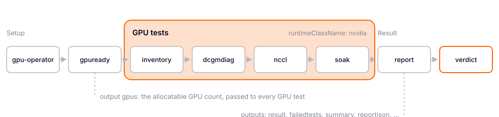

# GPU Burn-In Community Stack

This Stack qualifies one GPU server before it joins tenant capacity. A temporary tenant cluster
claims the server as its only private node. The Stack installs the NVIDIA GPU Operator and runs
these steps in order:

1. **GPU ready.** Waits for the device plugin to advertise GPUs.
2. **Inventory.** `nvidia-smi` checks the GPU count, model, uncorrected ECC errors and NVLink link
   state. It also records the server's DMI identity.
3. **DCGM diagnostics.** `dcgmi diag` at level 1 to 4, plus optional named tests such as
   `nvbandwidth` and `pulse_test`.
4. **NCCL.** `nccl-tests` all-reduce, all-gather and reduce-scatter across every GPU, with
   correctness checks and an optional bandwidth floor.
5. **Soak.** Sustained DCGM `targeted_stress` and `targeted_power` load, for up to 24 hours. It
   samples temperature, power, XID errors and throttle reasons the whole time.
6. **Report.** Collects every step's result into one pass or fail report in ConfigMap
   `gpu-burn-in-report`, and optionally uploads it to S3. The result, failed tests, summary and the
   full report (`reportjson`) are also published as Stack outputs.
7. **Verdict.** Fails the Stack unless the report says `passed`.

The Stack reports Healthy only when the server qualified. When it does not, the Stack goes Degraded
and the message names the failed tests. Either way the report stays readable.

The result then goes on the server's inventory record: a label and annotations on its Platform
Machine or BareMetalHost, a `QualificationReport` for history and dashboards, and optionally NetBox.
The [recorder controller](#the-recorder-controller) does this automatically and can also release
the server. Without it, run [automation/record-qualification.sh](automation/record-qualification.sh)
by hand. Every server ends labeled passed or failed, then goes back to the pool:



See [Qualify and quarantine servers](#qualify-and-quarantine-servers) for the NodeTypes that keep a
failed server away from customers.

Everything is built from existing vCluster Platform features: private nodes, Stacks, Argo CD and
Kubernetes Jobs. The tests run public NVIDIA images. The step logic is a small Helm chart in this
directory that Argo CD reads from Git.

> [!IMPORTANT]
> This Stack is not marked `vcluster.com/certified`, and vCluster Platform does not bundle it.

For other GPU burn-in and validation tools and how they compare with this Stack, see
[LANDSCAPE.md](LANDSCAPE.md). For which GPU generations the defaults support, and the overrides
Volta (V100) needs, see [GPU_SUPPORT.md](GPU_SUPPORT.md);
[example/gcp-v100/](example/gcp-v100/) runs it on a Google Cloud V100 VM.

## Contents

- [Architecture](#architecture)
- [Qualify and quarantine servers](#qualify-and-quarantine-servers)
- [Requirements](#requirements)
- [Files](#files)
- [Configure parameters](#configure-parameters)
- [Install](#install)
- [Run a qualification](#run-a-qualification)
- [Read the report](#read-the-report)
- [Test on simulated GPUs (nvml-mock)](#test-on-simulated-gpus-nvml-mock)
- [Test on a single real GPU](#test-on-a-single-real-gpu)
- [Upgrade](#upgrade)
- [Remove](#remove)
- [Known limitations](#known-limitations)
- [Troubleshooting](#troubleshooting)
- [Test changes](#test-changes)

## Architecture



| Task | Runs | Image | Timeout | Fails the server when |
| --- | --- | --- | --- | --- |
| `gpu-operator` | NVIDIA GPU Operator, with DCGM and dcgm-exporter when `telemetry` is on | NGC chart | `45m0s` | |
| `gpuready` | Waits up to 40 minutes for allocatable `nvidia.com/gpu` | `alpine/k8s` | `50m0s` | No GPU appears |
| `inventory` | `nvidia-smi -L`, `--query-gpu`, `topo -m`, `nvlink -s`, `-q -x`, DMI | DCGM | `20m0s` | Count differs from `expectedGPUs`, wrong model, uncorrected ECC, inactive NVLink, an unhealthy NVLink fabric or GPUs in different cliques |
| `dcgmdiag` | `dcgmi diag -r <level> -j`, then `-r <extra tests>` | DCGM | `4h30m0s` | Any DCGM result is Fail; a Skip too with `failOnSkip` |
| `nccl` | `all_reduce`, `all_gather` and `reduce_scatter` with `-c 1` | NGC PyTorch | `1h30m0s` | Non-zero exit, wrong results, bus bandwidth below the floor |
| `soak` | DCGM `targeted_stress` and `targeted_power` cycles, `dcgmi dmon` every 5s, NVLink error counters before and after | DCGM | `25h0m0s` | A DCGM Fail, any GPU above `maxGPUTempC`, an XID, NVLink errors growing past `maxNVLinkErrors`, or no load test actually ran |
| `report` | Collects the results, writes `gpu-burn-in-report`, uploads to S3 | `alpine/k8s` | `15m0s` | |
| `verdict` | Exits 1 unless the report says `passed` | `alpine/k8s` | `10m0s` | |

### Why Argo CD tasks

A Platform App deploy stops after 30 minutes. A DCGM level 4 run takes hours, and a soak takes as
long as you ask for. An `argoCDApplication` task waits as long as its own timeout. Argo CD reports
a running Job as Progressing, a completed Job as Healthy and a failed Job as Degraded. A Degraded
Application fails its task immediately, and the message names the failed resource.

Every step is the same chart, [chart/](chart/), deployed by the same template,
[apps/02-test.yaml](apps/02-test.yaml), with `test` choosing the step. The chart renders one Job per
step, plus its ServiceAccount, RBAC and scripts. The Job name carries a hash of its values. A Job
spec is immutable, so a changed setting creates a new Job, which runs the step again.

### How a test reports

Each GPU test pod has three containers:

| Container | Image | Does |
| --- | --- | --- |
| `gate` (init) | tools | With `stopOnFailure`, records a skip when an earlier step failed |
| `run` (init) | DCGM or NGC PyTorch | Runs `test-<step>.sh` under a deadline and keeps its raw output. Always exits 0 |
| `publish` | tools | Judges the output with [evaluate.sh](chart/files/evaluate.sh) and writes ConfigMap `gpu-burn-in-result-<step>` |

A result is `passed`, `failed` (the hardware missed the bar), `error` (the test could not run, for
example a timeout), `skipped` (an earlier step failed) or `disabled` (turned off by a parameter).
Every outcome still completes the Job, so a bad server always gets a report. Only `verdict` fails
its Job, after `report` has captured its outputs.

The NVIDIA images have no `kubectl` or `jq`, and the tools image has no NVIDIA tools. Splitting the
work between `run` and `publish` keeps the judging in one tested script and the NVIDIA images
unmodified.

### GPU access

The GPU tests don't request `nvidia.com/gpu` from the device plugin. They run with
`runtimeClassName: nvidia` and `NVIDIA_VISIBLE_DEVICES=all`, so they see every GPU the driver does.
The GPU Operator's own validator pods get their GPUs the same way. The tenant cluster has the server
to itself, so nothing else competes for the GPUs.

A request would break exactly when qualification matters most. When a GPU throws an XID or an
uncorrectable ECC error, the device plugin marks it unhealthy, and the node advertises 7 GPUs
instead of 8. A pod requesting 8 then stays Pending until its task times out, and no report is
written. Instead, the tests keep running, and `inventory` compares the GPUs `nvidia-smi` sees with
the GPUs the device plugin still advertises, failing with `device plugin advertises 7 of 8 GPUs:
one is unhealthy`. This was found on nvml-mock with an injected Xid 48.

`gpuready` still waits for the device plugin to advertise GPUs, which proves the driver, toolkit
and device plugin work. The count it saw is in its result and in the `gpus` output.

### DCGM and burn-in telemetry

With `telemetry: true`, the default, the GPU Operator runs its standalone DCGM host engine
(`nvidia-dcgm`) and `dcgm-exporter`. Temperature, power, utilization, XIDs, ECC and clocks then
stream to the Fleet Observability GPU dashboards for the whole burn-in. The DCGM steps run through
that same engine with `dcgmi --host nvidia-dcgm.gpu-operator.svc:5555`, so diagnostics and
telemetry never compete for the GPUs through two engines.

The one conflict is profiling. Active diagnostics and load need DCGM's profiling module, which
the exporter's `DCGM_FI_PROF_*` metrics hold. Each DCGM step pauses profiling with
`dcgmi profile --pause` and resumes it when the step ends. The dashboards' tensor, graphics-engine,
DRAM and PCIe-throughput panels go blank during a diagnostic or a load cycle; every other metric
keeps reporting.

With `telemetry: false`, neither runs. Each DCGM step starts its own `nv-hostengine` inside its pod,
on the GPUs the pod was given, and nothing is exported.

The `run` container of `dcgmdiag` and `soak` adds `SYS_ADMIN`, as NVIDIA's DCGM container
instructions do.

## Qualify and quarantine servers

The Stack produces evidence. It does not decide which servers customers get. That needs two more
pieces, both outside the Stack.

**1. Record the result on the inventory.** The tenant cluster is temporary, so its Node object is
not a durable record. The result has to land where the provisioning path looks. There are two
ways to write it there:

- **The [recorder controller](#the-recorder-controller)**, installed once on the vCluster Platform
  cluster. It records every run as its report is captured, and can also update NetBox and delete
  the tenant cluster. This is the way to run qualification at scale.
- **[automation/record-qualification.sh](automation/record-qualification.sh)**, run by hand per
  qualification. It is a dry run unless you pass `--apply`.

Both are optional; the Stack runs and reports without either. They differ in what they automate:

| | Stack alone | `record-qualification.sh` | Recorder controller |
| --- | --- | --- | --- |
| Runs the tests and writes the report (tenant ConfigMap, Stack outputs, optional S3) | Yes | Yes | Yes |
| Label and annotations on the BareMetalHost or Machine | No | Yes, by hand, per run | Yes, automatically |
| NetBox | No | `--netbox-device` | With `netboxUpdate` |
| QualificationReport, so the run shows in history and on dashboards | No | With `--create-report` | Yes |
| Deletes the tenant cluster | No | No | With `releaseServer` |
| Finds the server | No | You name it | From the NodeClaim |

With the script, record the run before you delete the tenant cluster, because it reads the report
there, or save the report first with `--save-report` and record from that file later.
`recordResult`, `netboxUpdate` and `releaseServer` only affect the controller. Don't use both on
the same run: they mark the run differently, so the controller records a run the script already
recorded. The label would be the same, but NetBox gets a second journal entry and the history a
second report.

Both write the same record:

- **The label:** `gpu-qualification.example.com/result=passed|failed`, plus annotations with the
  profile, time, failed tests, summary and report URI. Set the domain to one your organization
  owns (`labelDomain` for the controller, `LABEL_DOMAIN` for the script). Never use a
  `vcluster.com` or `loft.sh` domain: newer Platform builds keep labels in those domains out of
  NodeType selection, and both tools refuse them.
- **On the Machine (`machine`):** the preferred target from vCluster Platform v5.0.0-alpha.5. The
  Machine is provider-neutral, covering Metal3 and NICo, and lives on the management API, so
  nothing needs credentials for the cluster that runs Metal3. From v5.0.0-alpha.5, Metal3 and NICo
  NodeTypes select on Machine labels, with a Metal3 host's own labels laid over them. Earlier builds,
  such as the 4.13 alphas (4.13 was never released), accept the label on the Machine, but their
  Metal3 NodeTypes select on BareMetalHost labels only, so the label gates nothing; use `bmh`
  there.
- **On the BareMetalHost (`bmh`):** works on any build, because Metal3 NodeTypes always read the
  host's labels. From v5.0.0-alpha.5 the Platform also copies the label to the Machine; before
  that it stays on the host only.
- **Either way the record survives the teardown.** When the tenant cluster is deleted, the Metal3
  provider removes only its own project and NodeClaim labels. The qualification label and
  annotations stay, even after the host is wiped and returned to `available`.
- **NetBox, optionally**, for servers from a Metal3 provider's NetBox import:
  - On a failure, the device status is set to `failed`, and the import's tag is removed. The
    import then orphans the server, and removes it once the tenant cluster lets it go, so a
    failed server leaves the Platform instead of only carrying a label.
  - On a pass, a qualified tag is added.
  - Either way, a journal entry gets the failed tests and summary.

  Setup, the token, and what happens to a failed server are in the recorder's
  [NetBox](recorder/README.md#netbox) section. The script takes the same token in `NETBOX_TOKEN`.

**2. Enforce it.** A label alone does not stop allocation. Require it in the BareMetalHost selector
of every production NodeType, and point the qualification NodeType at hosts without it:

```yaml
nodeTypes:
  - name: rack-a-b300                 # production: qualified servers only
    bareMetalHosts:
      selector:
        matchLabels:
          netbox.vcluster.com/device-type: hgx-b300
          gpu-qualification.example.com/result: passed
  - name: rack-a-b300-qualification   # qualification: never-tested or failed servers
    bareMetalHosts:
      selector:
        matchLabels:
          netbox.vcluster.com/device-type: hgx-b300
        matchExpressions:
          - key: gpu-qualification.example.com/result
            operator: NotIn
            values: [passed]
    properties:
      vcluster.com/profile: b300-qualification
```

Verify that your node provider honors `matchExpressions` before you rely on the second selector.
If the NetBox import manages BareMetalHost labels, also check that it leaves this label alone.

The lifecycle is:

1. A new or repaired server is unlabeled, so only the qualification NodeType selects it.
2. Create a tenant cluster from **GPU Burn-In - Private Node** with `nodeTypeValue:
   b300-qualification`.
3. The recorder writes the result when the report is captured. With `releaseServer: true` it then
   deletes the tenant cluster. Without the recorder, run `record-qualification.sh --create-report
   --apply` and delete the tenant cluster yourself.
4. The server is wiped and becomes `available`.
5. A passed server is now visible to production NodeTypes. A failed one stays out until it is
   repaired and passes again.

### Cloud VMs and other servers without an inventory

A Terraform node provider, such as the Google Cloud or AWS auto nodes templates, creates a new VM
for each NodeClaim and deletes it with the tenant cluster. There is no lasting server, so there is
nothing to label, gate or quarantine. The Stack itself runs the same way. It needs only a NodeType
that the tenant cluster's `nodeTypeProperty` and `nodeTypeValue` select, and a driver the VM's
kernel can build. [example/gcp-v100/](example/gcp-v100/) is a complete example.

The recorder still records the run, as a report only:

- **A QualificationReport per node**, with the label `qualification.vcluster-stacks.io/no-inventory:
  "true"` and a `ReportOnly` event on the StackInstance. The report names the machine
  `<provider>.<node>`, as an inventory Machine would be named, so it shows on the dashboards. No
  Machine of that name exists.
- **No label and no NetBox update.** `netboxUpdate` has nothing to act on.
- **`releaseServer` still deletes the tenant cluster**, which deletes the VM.

Each VM gets a new node name, so every run is a new machine in the history. Use it to qualify a
GPU type, driver or image before relying on it, or to measure a baseline, such as NCCL bus
bandwidth for `ncclMinBusBandwidthGBps`. It doesn't track individual servers.

### The recorder controller

[recorder/](recorder/) is a small controller with its own Helm chart. Install it once on the
cluster that runs vCluster Platform. When a run's report is captured, it does the following:

1. It finds the server through the tenant cluster's NodeClaim. No `assetID` is needed.
2. It writes the record to the Machine or the BareMetalHost.
3. Optionally, it updates NetBox.
4. Optionally, it deletes the tenant cluster.

Each run is recorded once. The Stack parameters `recordResult`, `netboxUpdate` and
`releaseServer` set what it does per run.

Each run also becomes a `QualificationReport`: a cluster-scoped, never-changed record of one
qualification of one machine, with each test's status and metrics. It doesn't depend on how the
tests ran, so NICo Machine Validation or another test suite can fill the same fields. The recorder
serves Prometheus metrics computed from these reports for dashboards.

See the [recorder README](recorder/README.md) for install, configuration, permissions and
troubleshooting.

## Requirements

- vCluster Platform 4.12 or later. The Stack uses only APIs available in 4.12.
- vCluster 0.37 or later in the tenant cluster, for `deploy.stacks`. The template pins `0.37.2`.
- An Argo CD connector. You also need an Argo CD project that permits these sources and
  destinations:
  - The GPU Operator chart, `https://helm.ngc.nvidia.com/nvidia`.
  - This repository (or your fork) as a Git source.
  - The namespaces `gpu-operator` and `gpu-burn-in`.
- A node provider with the server, and a node type that selects only servers to qualify. A
  Terraform provider's cloud VMs work too; see
  [Cloud VMs](#cloud-vms-and-other-servers-without-an-inventory).
- Platform private nodes, with the VPN reachable by the server.
- A node OS and kernel the GPU Operator supports. Either the driver is preinstalled
  (`driverPreinstalled: true`), or the GPU Operator can pull and build it.
- Network access from the server to these sources:

  | Source | Used by |
  | --- | --- |
  | `nvcr.io` | GPU Operator images, `nvcr.io/nvidia/cloud-native/dcgm`, `nvcr.io/nvidia/pytorch` (about 10 GB) |
  | Docker Hub | `alpine/k8s`, the tools image |
  | The S3 endpoint | `report`, when `reportS3URI` is set |

## Files

| File | Purpose |
| --- | --- |
| [stacktemplate.yaml](stacktemplate.yaml) | StackTemplate `gpu-burn-in`: eight tasks, parameters and published outputs |
| [apps/01-gpu-operator.yaml](apps/01-gpu-operator.yaml) | ArgoCDApplicationTemplate `gpu-burn-in-gpu-operator` |
| [apps/02-test.yaml](apps/02-test.yaml) | ArgoCDApplicationTemplate `gpu-burn-in-test`: one step of the chart |
| [chart/](chart/) | The step chart: Job, RBAC and scripts. `files/evaluate.sh` holds every pass or fail rule |
| [virtualclustertemplate.yaml](virtualclustertemplate.yaml) | VirtualClusterTemplate `gpu-burn-in-private-nodes`: one server, the Argo CD integration and the Stack |
| [example/stackinstance.yaml](example/stackinstance.yaml) | StackInstance with an HGX B300 starting profile |
| [example/stackinstance-nvml-mock.yaml](example/stackinstance-nvml-mock.yaml) | StackInstance for simulated GPUs |
| [example/virtualclusterinstance-single-gpu.yaml](example/virtualclusterinstance-single-gpu.yaml) | Tenant cluster qualifying one real workstation GPU |
| [recorder/](recorder/) | The recorder controller (Go) and its Helm chart, [recorder/chart/](recorder/chart/) |
| [automation/record-qualification.sh](automation/record-qualification.sh) | Records a run by hand: a Machine or BareMetalHost label, NetBox, and a QualificationReport |
| [tests/evaluate-test.sh](tests/evaluate-test.sh) | Unit tests of the pass or fail rules, against [tests/fixtures/](tests/fixtures/) |
| [tests/nvml-mock-e2e.sh](tests/nvml-mock-e2e.sh) | End-to-end scenarios with injected faults on nvml-mock |
| [test-manifests.sh](test-manifests.sh) | Static and render checks, then the unit tests |

Every Platform object carries the label `app.kubernetes.io/part-of: gpu-burn-in-stack`.

## Configure parameters

Set these on the tenant cluster template, which passes the Stack parameters through
`deploy.stacks`. The tenant cluster template has every Stack parameter, plus `kubernetesVersion`,
`argoConnector`, `gpuNodeProvider`, `nodeTypeProperty` and `nodeTypeValue`.

| Parameter | Default | Purpose |
| --- | --- | --- |
| `expectedGPUs` | `8` | GPUs the server must have |
| `gpuModel` | empty | Substring every GPU name must contain, for example `B300` |
| `nvlinkFabric` | `auto` | NVLink fabric check. `auto` checks GPUs that report a fabric (GB200 and GB300 NVL trays) and skips HGX boards and PCIe GPUs. `required` also fails GPUs without one. `off` skips it |
| `assetID` | empty | The server's inventory name, recorded in the report |
| `profile` | `default` | Name for this set of thresholds, for example `b300-burnin-v1` |
| `stopOnFailure` | `true` | Skip the remaining tests after a failure |
| `runDCGMDiag` | `true` | Run `dcgmdiag`. Needs CUDA |
| `dcgmDiagLevel` | `3` | 1 quick, 2 medium, 3 long (about 30 minutes), 4 extended (hours) |
| `dcgmExtraTests` | empty | Named DCGM tests after the level, for example `nvbandwidth,pulse_test` |
| `failOnSkip` | `false` | Fail when DCGM skips a subtest |
| `runNCCL` | `true` | Run `nccl`. Needs CUDA |
| `ncclMaxBytes` | `1G` | Largest NCCL message size |
| `ncclMinBusBandwidthGBps` | `0` | Bus bandwidth floor per collective. `0` records without judging |
| `soakMinutes` | `60` | Soak length, 0 to 1440. `0` disables the soak |
| `soakLoad` | `dcgm` | `dcgm` loads the GPUs; `none` only records telemetry |
| `maxGPUTempC` | `90` | The soak fails above this |
| `maxNVLinkErrors` | `0` | The soak fails when a GPU's NVLink error counters grow by more than this: replay, recovery and CRC up to NVLink 4, and the NVLink 5 error counters on Blackwell. Counters that grow on healthy links are not counted: corrected FEC, raw symbol errors, BER and successful link recoveries |
| `reportS3URI`, `s3CredentialsSecret`, `s3Endpoint` | empty | Optional S3 copy of the report |
| `recordResult`, `netboxUpdate`, `releaseServer` | `true`, `false`, `false` | What the [recorder controller](#the-recorder-controller) does with this run. No effect without it |
| `nvmlMock` | `false` | `true` only on NVIDIA nvml-mock servers: validator and GPU Feature Discovery settings for simulated GPUs |
| `telemetry` | `true` | DCGM and dcgm-exporter during the burn-in, for the Fleet Observability dashboards. See [DCGM and burn-in telemetry](#dcgm-and-burn-in-telemetry) |
| `driverPreinstalled` | `false` | `true` when the node image has the NVIDIA driver |
| `driverVersion` | empty | The driver the GPU Operator builds, for example `580.126.20`. Empty uses the GPU Operator release's default. Pin a 580 driver for Volta; see [GPU_SUPPORT.md](GPU_SUPPORT.md) |
| `argoProject`, `chartRepoURL`, `chartRevision` | `default`, this repository, `main` | Where Argo CD reads the step chart |
| `gpuOperatorVersion`, `toolsImage`, `dcgmImage`, `ncclImage` | see [stacktemplate.yaml](stacktemplate.yaml) | Versions. Renovate tracks them |

Notes:

- **Thresholds come from known-good hardware.** `ncclMinBusBandwidthGBps` and `maxGPUTempC` have
  no universal right value. Run the Stack on servers you trust, record their numbers, and set the
  profile from those.
- **The DCGM image must match the driver.** DCGM 4.5 supports the 535, 570, 580 and 590 driver
  branches. The NGC PyTorch image needs a driver its CUDA version supports.
- **`soakMinutes` tops out at 1440.** The soak task's timeout is 25 hours, and the timeout is not
  a parameter.
- **Ownership.** The templates are owned by the `loft-admins` team. Change `spec.owner` if your
  installation uses another team.

## Install

All commands below go to the Platform **management API**. Get a kubeconfig with
`vcluster platform connect management`.

```bash
kubectl apply -f community-stacks/gpu-burn-in/apps/ \
  -f community-stacks/gpu-burn-in/stacktemplate.yaml \
  -f community-stacks/gpu-burn-in/virtualclustertemplate.yaml
```

To update templates that are already installed, use `kubectl replace -f` with the same files, not
`kubectl apply`. The management API merges a template's `spec.parameters` by position on apply, so
a parameter added, removed or moved can leave its neighbours with the wrong fields. In one case a
string parameter picked up `type: number`, and every new tenant cluster then failed with
`TemplateResolved=False`.

Apply the templates before creating a tenant cluster, never during a run. A task renders its
template when it starts, so a mid-run change reaches only the tasks that have not started yet.

To test changes to the chart, push them to a fork and set `chartRepoURL` and `chartRevision`. Argo
CD reads the chart from Git, not from your checkout.

## Run a qualification

Create a tenant cluster from **GPU Burn-In - Private Node** under **Tenant Clusters > New Tenant
Cluster**, and select the server with `nodeTypeProperty` and `nodeTypeValue`. Or apply a
VirtualClusterInstance like
[example/virtualclusterinstance-single-gpu.yaml](example/virtualclusterinstance-single-gpu.yaml).

To run the Stack in an existing tenant cluster, apply a StackInstance in the project namespace,
such as [example/stackinstance.yaml](example/stackinstance.yaml). The tenant cluster needs the
Argo CD integration and exactly one GPU node, with nothing else using its GPUs and no other GPU
Operator installed.

Follow the tasks on the management API:

```bash
kubectl -n <project-namespace> get stackinstance <name> \
  -o jsonpath='{.status.phase}{"\n"}{range .status.tasks[*]}{.name}{"\t"}{.phase}{"\t"}{.message}{"\n"}{end}'
```

With the tenant cluster kubeconfig, follow a step:

```bash
kubectl -n gpu-burn-in get jobs,pods
kubectl -n gpu-burn-in logs -l app.kubernetes.io/component=soak -c run -f
kubectl -n gpu-burn-in get configmaps -l gpu-burn-in.vcluster.com/result=true \
  -o custom-columns=TEST:.data.test,STATUS:.data.status,SUMMARY:.data.summary
```

## Read the report

The StackTemplate publishes `result`, `failedtests`, `summary`, `host`, `assetid`, `gpucount`,
`reporturi` and `finishedat`. Platform builds that serve the `stackinstances/outputs`
subresource return them from the StackInstance:

```bash
kubectl get --raw "/apis/management.loft.sh/v1/namespaces/<project-namespace>/stackinstances/<name>/outputs"
```

The full report is in the tenant cluster:

```bash
kubectl -n gpu-burn-in get configmap gpu-burn-in-report -o jsonpath='{.data.report\.json}' | jq
```

```json
{
  "schema": "gpu-burn-in.vcluster.com/v1",
  "result": "failed",
  "failedTests": ["nccl", "soak"],
  "summary": "nccl failed: all_gather 98.12 GB/s below 300; soak skipped: an earlier test failed: nccl",
  "assetID": "b300-rack-a-u12",
  "profile": "b300-burnin-v1",
  "host": {"name": "...", "labels": {"...": "..."}, "dmi": {"product_serial": "..."}},
  "expectedGPUs": 8,
  "detectedGPUs": 8,
  "gpus": [{"index": 0, "uuid": "GPU-...", "name": "NVIDIA B300 ...", "serial": "...", "uncorrectedECC": 0}],
  "tests": [{"test": "inventory", "status": "passed", "summary": "8 x NVIDIA B300 ...", "node": "...", "details": {}}],
  "nodes": [{"name": "...", "result": "failed", "failedTests": ["nccl", "soak"], "summary": "..."}]
}
```

`nodes` gives each node its own verdict, from the tests that ran on it, and a test with no
result counts against every node. With one server it has one entry, matching `result`. The
recorder records each machine's own entry, so a run over several servers fails only the ones that
failed.

Each test's `details` holds its measurements. These include the DCGM results by test name, NCCL bus
bandwidth per collective, and per-GPU peak temperature, peak power, last XID and throttle samples
from the soak. Each result ConfigMap also keeps the last 256 KiB of its test's log.

## Test on simulated GPUs (nvml-mock)

NVIDIA's [nvml-mock](https://github.com/NVIDIA/k8s-test-infra) simulates the driver on a node:
`nvidia-smi`, NVML, the device plugin and DCGM telemetry, for any GPU count and model. It has no
CUDA, so only part of the Stack can run on it.

| Step | On nvml-mock | Why |
| --- | --- | --- |
| `gpu-operator`, `gpuready` | Runs | The device plugin advertises the simulated GPUs. Driver and toolkit are skipped by node label |
| `inventory` | Runs | `nvidia-smi` reports count, model and ECC from the simulation |
| `dcgmdiag` | Disable (`runDCGMDiag: false`) | Needs CUDA |
| `nccl` | Disable (`runNCCL: false`) | Needs CUDA |
| `soak` | Telemetry only (`soakLoad: none`) | `dcgmi dmon` reads the simulation; there is no load to apply |
| `report`, `verdict`, outputs | Runs | |

Set `nvmlMock: true`. The GPU Operator's validator otherwise tries to load the NVIDIA kernel module
and run a CUDA workload, and the device plugin waits for it forever.

That covers the task graph, the `gpuready` output, the unhealthy-GPU check, stop-on-failure, the soak's
thermal and XID checks, the report and its outputs, and the verdict. Use
[example/stackinstance-nvml-mock.yaml](example/stackinstance-nvml-mock.yaml), or run the scenarios
with injected faults:

```bash
community-stacks/gpu-burn-in/tests/nvml-mock-e2e.sh --project default \
  --provider <metal3-provider> --argo-connector <connector> \
  --node-type-property vcluster.com/accelerator --node-type-value b200 \
  --chart-repo https://github.com/<fork>/vcluster-stacks.git --chart-revision <branch>
```

| Scenario | Fault | Expected |
| --- | --- | --- |
| `pass` | none | `passed`, Stack Healthy |
| `missing-gpu` | `expectedGPUs` one more than the server has | `failed: inventory,soak` (soak skipped by stop-on-failure) |
| `wrong-model` | `gpuModel: H100` on B200 simulations | `failed: inventory,soak` |
| `thermal` | `nvml-mock-ctl temp --gpu 0 142` during the soak | `failed: soak`, above `maxGPUTempC` |
| `xid` | `nvml-mock-ctl fail --gpu 0 --mode ecc_uncorrectable --xid 48` during the soak | `failed: soak`, Xid 48 |

Both faults during the soak are verified: the thermal spike fails the soak with `above 90C: GPU 0
95C` (nvml-mock caps the reported temperature at 95 C), and the injected Xid fails it with `GPU 0
Xid 48`, because DCGM's last-XID field reflects the simulated error.

NVLink faults, for the GB200 and GB300 profiles, which simulate an NVL72 tray's fabric:

| Fault | Expected | Status |
| --- | --- | --- |
| `nvml-mock-ctl fabric-health --gpu 1 route_unhealthy` before `inventory` | `failed: inventory`, `NVLink fabric: GPU 1 summary=Unhealthy, route_unhealthy=True` | Verified 2026-10-21 on a simulated GB300 tray: only GPU 1 failed, all four registered in one clique |
| `nvml-mock-ctl fabric-health --gpu 0 degraded_bandwidth`, or a misconfiguration such as `no_partition` | `failed: inventory`, naming the condition | Fixture tests only |
| `nvml-mock-ctl nvlink-error --gpu 0 100` during the soak | `failed: soak`, `NVLink errors during the soak: GPU 0 +<count>` | Verified 2026-10-21 on a simulated GB300 tray: only GPU 0 grew, and inventory passed. The count sums every error counter on every link, which nvml-mock raises together, so it runs into the millions |

## Test on a single real GPU

A single workstation GPU, such as an RTX 2000 Ada, runs every step with real CUDA:

- `nccl` runs with one rank. That proves the image, CUDA and NCCL work, but the bandwidth is not
  meaningful.
- DCGM diagnostics target data center GPUs, so some tests may report Skip. The report records
  every skip. The soak fails if DCGM skips every load test, because then it never loaded the GPU.
- There is no NVLink to check.

See [example/virtualclusterinstance-single-gpu.yaml](example/virtualclusterinstance-single-gpu.yaml).

## Upgrade

- **Versions.** Change `gpuOperatorVersion`, `dcgmImage`, `ncclImage` or `toolsImage`, or update
  the defaults. Renovate tracks the defaults in this directory.
- **The step chart.** Argo CD reads `chartRevision`. Pin it to a tag or commit for reproducible
  qualifications, and record the revision in `profile`.
- **Template parameters on existing tenant clusters.** These tenant clusters are meant to be
  short-lived. If you keep one, a new template parameter reaches it only after **Sync Template**.

## Remove

Delete the tenant cluster when its result is recorded. That removes the Stack and releases the
server to its node provider, which wipes it. To remove the Stack from a tenant cluster you keep:

```bash
kubectl -n <project-namespace> delete stackinstance <name>
```

Argo CD prunes the GPU Operator and every step's Job and RBAC. These remain in the tenant cluster:

- The namespaces `gpu-operator` and `gpu-burn-in`.
- The result ConfigMaps and `gpu-burn-in-report`. The steps create them, not Argo CD, so the
  evidence outlives the Stack.

Remove the templates when nothing references them:

```bash
kubectl delete argocdapplicationtemplates,stacktemplates,virtualclustertemplates \
  -l app.kubernetes.io/part-of=gpu-burn-in-stack
```

## Known limitations

- **One server per tenant cluster.** The Stack tests the GPUs inside one server and the NVLink
  links that server can see. It does not test the fabric between servers. See
  [Rack-scale and multi-rack fabric](#rack-scale-and-multi-rack-fabric).
- **It starts from a booted OS.** A fault that stops the kernel, kubelet or driver from coming up
  shows up as a `gpuready` failure or a tenant cluster that never gets a node. It is not diagnosed
  further. Out-of-band checks such as BMC, Redfish and power-on self-test are outside the Stack.
- **Re-running in the same tenant cluster.** The stop-on-failure gate reads every result
  ConfigMap in the namespace. Use a fresh tenant cluster per qualification, or delete the
  `gpu-burn-in-result-*` ConfigMaps first.
- **Thresholds are not built in.** The defaults catch broken hardware. Telling a marginal server
  from a good one needs baselines from known-good servers of the same model.
- **Telemetry is coarse.** `dcgmi dmon` samples every 5 seconds. The soak judges peak temperature
  and the last XID. Throttle samples are recorded but do not fail the soak, because power capping
  under full load is normal.
- **Privilege.** `dcgmdiag` and `soak` add `SYS_ADMIN` to their test container. The tenant
  cluster exists only for the qualification.
- **Enforcement is yours.** The Stack and the recording script produce a result and a label. Only a
  NodeType selector, or an equivalent gate in your provisioning path, keeps a failed server away
  from customers.

### Rack-scale and multi-rack fabric

A server that passes here can still fail as part of a rack. A GB300 NVL72 rack is one NVLink
domain: 18 compute trays of 4 GPUs each, joined through 9 NVLink switch trays, and it is meant to
run as one 72-GPU system. Qualifying each tray on its own sees 4 GPUs and never crosses the switch
trays, so it cannot find a bad switch tray, a bad NVLink cable cartridge, or a slow path between two
trays. Qualifying a rack needs what this Stack does not have:

- One tenant cluster that claims every tray in the rack as its private nodes, not one per server.
- Multi-node NVLink set up across the trays: NVIDIA IMEX, which on Kubernetes the NVIDIA DRA driver
  for GPUs manages as ComputeDomains.
- NCCL and bandwidth tests launched across all 72 GPUs, plus NVLink switch health from the rack's
  NVLink management, not just from `nvidia-smi` on each tray.
- A result for the rack as a whole that still names the failing tray or switch tray.
  QualificationReports, the recorder and the dashboards record one machine at a time.

Between racks, the fabric is the east-west network: InfiniBand or Spectrum-X Ethernet through each
server's ConnectX or BlueField NICs. Testing it needs the RDMA devices in the tenant cluster (for
example through the NVIDIA Network Operator), `perftest` bandwidth and latency between servers,
NCCL across racks over RDMA, and the switch side's port errors and link flaps. Its result belongs
to a set of racks or a fabric, not a server. None of that is in this Stack. NVIDIA Cluster Readiness
Engine covers part of this ground; [NVCRE.md](NVCRE.md) is a plan for integrating it as an optional
step.

## Troubleshooting

- **`gpuready` failed: no `nvidia.com/gpu` advertised.** The driver, toolkit or device plugin did
  not come up. Check `kubectl -n gpu-operator get pods` and the driver pod's log. That is a
  finding about the server and its image, and the report records it.
- **`gpu-operator` Failed with `CRD ... is not established`.** Argo CD briefly reports the GPU
  Operator Degraded while its CRDs register, and the Platform fails a task as soon as its
  Application is Degraded. It usually goes Healthy again on its own within a minute. If it
  stays Failed after the Application is Healthy, retry the task:
  `kubectl -n <project-namespace> annotate stackinstance <name> platform.vcluster.com/stack-retry=gpu-operator --overwrite`.
- **`gpu-operator` stays Progressing while the Argo CD sync stalls.** On the test lab, the sync
  stalled twice: once at `Creating namespace`, with nothing created, and once at `waiting for
  completion of hook batch/Job/gpu-operator-upgrade-crd`, minutes after that Job had completed.
  Terminate the Application's operation
  (`kubectl -n argocd patch application <name> --type merge -p '{"status":{"operationState":{"phase":"Terminating"}}}'`).
  In the hook case that was enough, and the task went Healthy. If it stays stuck, restart
  `argocd-application-controller`, then retry the task as above.
- **`nvidia-dcgm-exporter` in CrashLoopBackOff, `Failed to connect to remote hostengine`.** With
  `telemetry`, the exporter can start before the standalone host engine accepts clients. It
  recovers on its own after a few restarts, usually within two minutes.
- **On nvml-mock, `nvidia-operator-validator` in `Init:Error`, `failed to load module nvidia`.**
  Set `nvmlMock: true`. Simulated GPUs have no kernel module to load, and no CUDA for the
  validation workload.
- **A test is `error`, not `failed`.** The test could not run: a timeout, a host engine that did
  not start, or a missing binary. Read the `run` container log, or the `log` key of its result
  ConfigMap.
- **`dcgmdiag` reports no JSON.** The DCGM version may not support the GPU or the requested level.
  Check `dcgmi diag` output in the log, and whether the DCGM image supports the driver branch.
- **`nccl` exits non-zero right away.** The PyTorch image's CUDA version needs a newer driver, or
  `/usr/local/bin` has no nccl-tests binaries in the image you chose.
- **A task waits with `CapturingOutputs`.** The step's ConfigMap is missing a key the output reads.
  This usually means the task rendered from a stale template. See [Install](#install).
- **`verdict` Degraded.** This is the expected outcome for a server that did not qualify. Its
  message lists the failed tests, and the report has the details.
- **Argo CD `ComparisonError` on a step.** The Argo CD project does not permit `chartRepoURL`, or
  the revision does not exist in that repository.

## Test changes

From the repository root, run the static checks. They need bash 4 or later, python3 with PyYAML,
helm, jq and sh.

```bash
./community-stacks/gpu-burn-in/test-manifests.sh
```

The checks render every task for the default parameters, the nvml-mock parameters and a variant
with the soak off and S3 on. They render each StackTemplate task, then its ArgoCDApplicationTemplate, then
the chart with the resulting Helm values. They assert:

- Names carry the `gpu-burn-in` prefix and the `part-of` label, and match their files. Every chart
  value is a template parameter, and defaults agree across the StackTemplate, the templates and
  the chart.
- The tasks form one chain in the expected order, all as Argo CD tasks. Timeouts are in canonical
  Go duration form, and each exceeds its step's own deadline by 5 minutes, up to a maximum-length
  soak.
- Outputs come from the `gpu-burn-in` namespace, from keys the steps write. Every `.Outputs`
  reference reads a declared output of a dependency.
- Each step renders exactly one Job that runs once. Disabled tests start no NVIDIA container. DCGM and dcgm-exporter follow
  `telemetry`, and the DCGM steps use the shared host engine exactly when they run. GPU tests run
  with the NVIDIA runtime class instead of a device plugin request, and no Job asks Argo CD to
  replace it. `verdict` receives the report's outputs.
- The tenant cluster template claims exactly one server and passes every Stack parameter.

They check that `record-qualification.sh --create-report` builds a QualificationReport that matches
the CRD schema, from [tests/reports/](tests/reports/).

They then run [tests/evaluate-test.sh](tests/evaluate-test.sh). It runs the pass or fail rules
against fixtures for each test and failure mode, and the report against combinations of results.
The fixtures are hand-written in the formats `nvidia-smi`, `dcgmi diag -j`, nccl-tests and
`dcgmi dmon` print. Replace them with captured output when a real run is available.

CI also runs a server-side dry run of every manifest against vCluster Platform.

### Tested

**RTX 2000 Ada, 2026-10-20.** vCluster Platform 4.13.0-alpha.19, a Metal3 bare metal host with
one RTX 2000 Ada passed through to the server VM, Ubuntu 24.04 with kernel 6.8, and the driver built
by the GPU Operator. Every step passed, and the Stack went Healthy:

| Step | Result |
| --- | --- |
| `gpuready` | 1 allocatable `nvidia.com/gpu` |
| `inventory` | 1 x NVIDIA RTX 2000 Ada Generation |
| `dcgmdiag` | Level 2 passed: `pcie` and `software` passed, `memory` skipped on this GPU |
| `nccl` | Passed with one rank. Bus bandwidth is 0 GB/s by definition with one GPU |
| `soak` | 15 minutes of DCGM load, one cycle, peak 78 C |

That run confirmed several things:

- The DCGM 4.5 JSON evaluation and the outputs chain from `report` to `verdict` work as designed.
- The recorder controller, run in dry-run mode from a workstation against the live run, found the
  server from the NodeClaim and read its BareMetalHost on the Metal3 cluster through a kubeconfig.
- It reacted within seconds of the report's outputs being captured.

That run used the Stack without the telemetry change (each DCGM step had its own host engine).

**RTX 2000 Ada with `telemetry: true`, 2026-10-20.** Every step passed again, with the DCGM
diagnostics and the soak running through the GPU Operator's `nvidia-dcgm` and the profiling pause
working (`Successfully paused profiling`). dcgm-exporter restarted four times before the host
engine accepted it, then served metrics. The recorder, running from a workstation, recorded
`passed` on the BareMetalHost and deleted the tenant cluster (`releaseServer`).

**nvml-mock B200 server with an injected fault, 2026-10-20.**
`nvml-mock-ctl fail --gpu 0 --mode ecc_uncorrectable --xid 48`, injected while `gpuready` ran:

- `inventory` failed with `uncorrected ECC errors: GPU 0=2; device plugin advertises 7 of 8 GPUs:
  one is unhealthy`.
- The soak was skipped by stop-on-failure, and the report said `failed: inventory,soak`.
- The recorder wrote `result=failed` and the summary to the server's BareMetalHost, then released
  it.

The run also showed what nvml-mock needs from the GPU Operator (`nvmlMock`). It also showed why GPU
tests must not request `nvidia.com/gpu`: the unhealthy GPU left a pod requesting 8 Pending, before
this was changed.

**Fleet-scale recorder and dashboards, 2026-10-20.** With the recorder in-cluster (`sha-a6c8deb`),
three more runs were recorded with topology from NetBox (`site`, `location` and `rack`):

- **nvml-mock thermal failure:** `nvml-mock-ctl temp --gpu 0 142` one minute into the soak failed it
  with `above 90C: GPU 0 95C`.
- **RTX 2000 Ada:** passed again, with DCGM level 2, NCCL and a 15-minute DCGM soak at 78 C and 70 W.
- **nvml-mock XID failure:** `nvml-mock-ctl fail --gpu 0 --mode ecc_uncorrectable --xid 48` during the
  soak failed it with `GPU 0 Xid 48`. That server's two failures in a row show as
  `gpu_qualification_consecutive_failures` 2 on the Failures dashboard.

**NetBox, 2026-10-21.** A failing nvml-mock run with `netboxUpdate: true` set NetBox device 2 to
`failed`, removed its `vcluster-sync` tag and added a `danger` journal entry naming `inventory`.
The import marked the Machine `Orphaned` and kept it while the tenant cluster held it. Once the
tenant cluster was deleted, the import removed the BareMetalHost and Machine within about two
minutes, and the QualificationReports stayed. Tagged and active again, it came back with no result
label. See the
recorder's [Tested](recorder/README.md#tested) section.

Not exercised yet:

- Any multi-GPU server, NVLink, DCGM levels 3 and 4, or an NCCL bandwidth floor.
- A failing server on real hardware. The fixtures and nvml-mock cover the failure paths.
- The `nvml-mock-e2e.sh` scenarios as a script. The same faults were run by hand.
- The recorder's `machine` target. Its unit tests cover it against a fake API server.
- The S3 upload.

## License

This Stack is part of this repository and is licensed under the
[Apache License 2.0](../../LICENSE).
