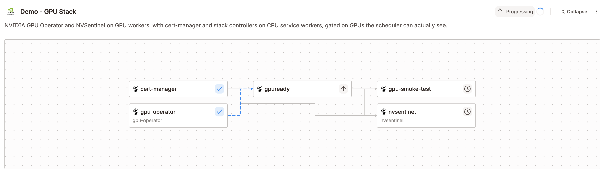

# NVIDIA GPU Operator Community Stack

This Stack turns a tenant cluster with private GPU nodes into a working NVIDIA GPU cluster. It
installs these components in dependency order:

- The [NVIDIA GPU Operator](https://docs.nvidia.com/datacenter/cloud-native/gpu-operator/latest/),
  through Argo CD, with either the device plugin or Dynamic Resource Allocation (DRA). See
  [GPU driver mode](#gpu-driver-mode).
- [NVSentinel](https://github.com/NVIDIA/NVSentinel), through Argo CD. By default it cordons a GPU
  node when it detects a fault there. Draining is opt-in, and it never reboots nodes. See
  [NVSentinel fault handling](#nvsentinel-fault-handling).
- A task that resolves the GPU driver mode, two readiness gates and a CUDA smoke test, as
  vCluster Platform Apps.

The gates hold the downstream tasks until the scheduler advertises GPUs and the DCGM host engine
is serving. The Stack reports healthy only after a CUDA workload has run on a GPU worker.

Everything the Stack deploys is in this directory or comes from a public upstream chart. The gate
Jobs run the vCluster Platform image the Platform already uses, so the Stack has no image or chart
of its own to build or publish.

The files in this directory are the source manifests, an example and the checks for the
`nvidia-gpu-operator` StackTemplate.

> [!IMPORTANT]
> This Stack is not marked `vcluster.com/certified`, and vCluster Platform does not bundle it.

## Contents

- [Architecture](#architecture)
- [Requirements](#requirements)
- [Files](#files)
- [Configure parameters](#configure-parameters)
- [Install](#install)
- [Verify](#verify)
- [Upgrade](#upgrade)
- [Remove](#remove)
- [Known limitations](#known-limitations)
- [Troubleshooting](#troubleshooting)
- [Test changes](#test-changes)

## Architecture

```text
discover (00) ---> gpu-operator (01) ---> gpuready (02) --+--> dcgmready (02) ---+
                                                          |                       +--> nvsentinel (03)
                                                          +-----------------------+
                                                          |
                                                          +--> gpu-smoke-test (03)
```

Every task after `discover` also depends on `discover` directly, because it reads the resolved
mode from `discover`'s outputs. The diagram leaves those edges out.

| Task | Type | Template | `dependsOn` | Timeout | Function |
| --- | --- | --- | --- | --- | --- |
| `discover` | `app` | `nvidia-gpu-operator-discover` | none | `6m0s` | Resolves `gpuDriverMode` to `device-plugin` or `dra` and publishes the names that mode uses. |
| `gpu-operator` | `argoCDApplication` | `nvidia-gpu-operator-gpu-operator` | `discover` | `45m0s` | Installs the GPU Operator in the resolved mode. Controllers run on the CPU pool and node agents on the GPU pool. |
| `gpuready` | `app` | `nvidia-gpu-operator-gate` | `discover`, `gpu-operator` | `28m0s` | Gate. Waits until `minGPUs` GPUs are available, then marks ConfigMap `gpu-stack-contract` ready. |
| `dcgmready` | `app` | `nvidia-gpu-operator-gate` | `discover`, `gpuready` | `15m0s` | Gate. Waits for the DCGM DaemonSet (`nvidia-dcgm`, or `nvidia-dcgm-dra` with DRA) to finish rolling out on every GPU node. Publishes nothing. |
| `gpu-smoke-test` | `app` | `nvidia-gpu-operator-gpu-smoke-test` | `discover`, `gpuready` | `12m0s` | Runs NVIDIA's CUDA VectorAdd sample on the GPU pool. |
| `nvsentinel` | `argoCDApplication` | `nvidia-gpu-operator-nvsentinel` | `discover`, `gpuready`, `dcgmready` | `20m0s` | Installs NVSentinel in the resolved mode, cordoning faulty GPU nodes by default. Reads its DCGM address from the gate's contract. |

The Stack mixes two task types. **The workloads are Argo CD Applications**: once the Stack has
ordered the rollout, Argo CD owns their reconciliation and drift correction. **The gates and the
smoke test are Platform Apps**, and so is `discover`: their manifests, a Job with its RBAC, live
inline in `apps/`.

An `argoCDApplication` task is ready when its Application reports both `Synced` and `Healthy`. An
`app` task is ready when the Platform's Helm deploy finishes. The Apps set `wait: true`, so Helm
waits for the Job to complete. A task that declares outputs is ready only after it has captured
them.

The timeouts use the full Go duration form, with seconds. `timeout` is a `metav1.Duration`, so
the API server stores `45m` as `45m0s`. If Argo CD manages the StackTemplate, that difference is
permanent drift.

### GPU driver mode

The GPU Operator can expose GPUs to Kubernetes in two ways. The `gpuDriverMode` parameter chooses
one, and every task follows it:

| | `device-plugin` | `dra` |
| --- | --- | --- |
| GPU Operator CR | `ClusterPolicy` | `GPUCluster` (experimental in the GPU Operator), plus an `NVIDIADriver` CR for the driver |
| How pods get a GPU | `resources.limits: nvidia.com/gpu` | A ResourceClaim on DeviceClass `gpu.nvidia.com` |
| What `gpuready` counts | `nvidia.com/gpu` in node allocatable | Devices of type `gpu` that driver `gpu.nvidia.com` publishes in ResourceSlices |
| DCGM DaemonSet and Service | `nvidia-dcgm` | `nvidia-dcgm-dra` |
| Smoke test | Requests `nvidia.com/gpu` | Requests a GPU through a ResourceClaimTemplate |
| NVSentinel | `global.gpuDraEnabled: false`. The metadata collector uses the `nvidia` RuntimeClass. | `global.gpuDraEnabled: true`. The metadata collector holds a DRA admin-access claim on the node's GPUs. Namespace `nvsentinel` is labeled `resource.kubernetes.io/admin-access=true`. |
| Kubernetes | Any supported version | 1.34 or later (`resource.k8s.io/v1`) |

NVSentinel must run in the same mode as the GPU Operator. In DRA mode there is no `nvidia`
RuntimeClass, so a device-plugin NVSentinel never collects GPU metadata. In device-plugin mode
there are no ResourceSlices to claim.

`auto`, the default, decides at install time:

- If the cluster already has a `GPUCluster`, it uses `dra`.
- If it already has a `ClusterPolicy`, it uses `device-plugin`.
- If it has both, `discover` fails, because the GPU Operator rejects that state.
- If it has neither, as on a new cluster, it installs `device-plugin`.

`device-plugin` and `dra` skip detection.

`discover` decides once and writes the result into ConfigMap `gpu-driver-mode` in `gpu-stack`.
The other tasks read the mode and the mode-specific names (CR, DCGM DaemonSet and host, what to
count for capacity) from its outputs. They never read the parameter, so `auto` cannot leave two
tasks on different modes. Like the gates, `discover`'s Job name carries a hash of its settings.
It decides again only when `gpuDriverMode` changes, so later reconciles with unchanged settings
keep the earlier decision.

The StackTemplate publishes the resolved mode as the output `gpudrivermode`.

### The gpuready gate

The GPU Operator Application goes `Healthy` as soon as Argo CD has created its resources. That
can be minutes to an hour before a driver is built, the device plugin has registered and the
scheduler admits a pod that requests `nvidia.com/gpu`.

A custom Argo CD health check cannot close that gap. It is a function of one resource the
Application manages, so it cannot sum allocatable GPUs across nodes or publish what it learned.
Health checks also live in `argocd-cm` or in Argo CD itself, so they cannot travel inside a
Stack.

The gate is a Job instead. `gpuready` deploys the gate App, whose Job counts GPUs on nodes labeled
`workload.example.com/pool=gpu-compute`. With the device plugin it sums allocatable
`nvidia.com/gpu`. With DRA it counts the devices of type `gpu` that the `gpu.nvidia.com` driver
publishes in ResourceSlices for those nodes, because DRA devices never appear in node
allocatable. When the count reaches `minGPUs`, the Job patches `ready`, `observedCount`,
`resourceName` and `verifiedAt` into the `gpu-stack-contract` ConfigMap in the `gpu-stack`
namespace. Helm waits for the Job, so the task stays `Progressing` until then.



*GPU Operator reports healthy, but `gpuready` holds, so the downstream tasks wait with it. The
screenshot is from an earlier version of this Stack that also installed cert-manager.*

`gpuready` declares Stack outputs read from the contract. Downstream tasks consume them instead
of hard-coding values:

```yaml
# nvsentinel
dcgmHost: '{{ .Outputs.gpuready.dcgmhost }}'
# gpu-smoke-test
gpuNodeSelector: 'workload.example.com/pool={{ .Outputs.gpuready.gpupool }}'
```

The StackTemplate also publishes `gpucount`, `gpupool`, `dcgmhost` and `dcgmport` as Stack
outputs.

By default the gate does not wait on `ClusterPolicy`. `ClusterPolicy` aggregates every GPU
Operator operand, so it stays `notReady` while `dcgm-exporter` loses a startup race that nothing
downstream depends on. In a measured run that cost about 90 seconds. Set `waitForClusterPolicy`
to `true` to hold for the whole operand set. In DRA mode it waits on the `GPUCluster` instead.

### The dcgmready gate

The GPU Operator creates `dcgm-exporter` and `nvidia-dcgm` at the same time, with nothing
ordering them. Without this gate, NVSentinel can start before the DCGM host engine is serving
and report `GpuDcgmConnectivityFailure`.

`dcgmready` runs the same gate App with different parameters: `kubectl rollout status` on
`daemonset/nvidia-dcgm` (`nvidia-dcgm-dra` with DRA), which covers any number of GPU workers. It depends on `gpuready`
because a DaemonSet that schedules no pods yet has already finished rolling out. Waiting for a
GPU node first makes the rollout wait meaningful.

### The gate App

[apps/02-gate.yaml](apps/02-gate.yaml) is workload-agnostic. Its parameters choose what to wait
for (`waitResource`, `waitCondition`, or `rollout`), what capacity to count (`capacitySource`,
`capacityResource`, `capacityDeviceType`, `capacityMin`, `capacityNodeSelector`) and what contract
to publish (`contractName`, `contractData`). `capacitySource` is `allocatable` for an extended
resource or `resourceslices` for a DRA driver. The GPU-specific keys are in the StackTemplate, with the tasks that use them.

The Job runs `.Values.__image__`, which the Platform sets to its own image when an App's
manifests reference it. That image has `sh` and `kubectl`, which is all the gate script needs.
It also matches the installed Platform version, so there is no image to build, publish or pin.
The `resourceslices` count also uses `jq`, which the image includes.

App tasks behave differently from Argo CD tasks in two ways:

- **No parameter defaults.** A Stack task's AppInstance does not apply App parameter defaults.
  The tasks pass every value the gate relies on, and the manifests guard each one with
  `default`. Booleans arrive as the strings `"true"` and `"false"`.
- **A 30 minute cap.** The Platform stops any App deploy after 30 minutes. The gate App's
  `timeout` is `25m`, `gpuready` gives its Job a 1380 second deadline, and the task timeout of
  `28m0s` sits above both. The Job deadline fires first, so a stuck gate fails with a reason in
  its log.

### Node placement

Two NodeProfiles in [nodeprofiles.yaml](nodeprofiles.yaml) define what the tenant cluster
scheduler sees:

| NodeProfile | Node label | Taints |
| --- | --- | --- |
| `nvidia-gpu-operator-cpu-services` | `workload.example.com/pool=cpu-services` | none |
| `nvidia-gpu-operator-gpu-compute` | `workload.example.com/pool=gpu-compute` | `nvidia.com/gpu=true:NoSchedule` |

Pods reach a pool through a `nodeSelector` on `workload.example.com/pool`. Pods that select
`gpu-compute` also tolerate the GPU taint.

| Components | Placement |
| --- | --- |
| GPU Operator controller, NFD master and garbage collector | CPU pool |
| NFD workers | GPU pool, with the GPU taint toleration |
| NVIDIA driver, toolkit, device plugin, validators, DCGM. With DRA: driver, DRA kubelet plugin, DRA validator, DCGM. | Operator-managed GPU selectors, with the GPU taint toleration |
| `discover` and gate Jobs | CPU pool. They only talk to the API server. |
| CUDA smoke test | GPU pool, with the GPU taint toleration and a GPU request or ResourceClaim |
| NVSentinel labeler | CPU pool |
| NVSentinel health monitors, metadata collector, `platformConnector` | GPU pool, with the GPU taint toleration |

The CPU pool label value is the `cpuNodePool` parameter. The GPU pool value `gpu-compute` is
fixed in the templates.

The profiles do not use `startupTaints`. Those are removed when the node becomes Ready, which
does not prove that NVIDIA initialization has completed. The `gpuready` gate handles GPU
readiness at the Stack level.

## Requirements

- vCluster Platform 4.12 or later. The Stack uses only APIs available in 4.12.
- vCluster 0.37 or later in the tenant cluster for `deploy.stacks`. The tenant cluster template
  pins `0.37.6`.
- For `gpuDriverMode: dra`, Kubernetes 1.34 or later, which serves `resource.k8s.io/v1`. The GPU
  Operator chart refuses to deploy a `GPUCluster` on a cluster without a DRA API.
- An Argo CD connector in the Platform. You also need an Argo CD project that permits the GPU
  Operator and NVSentinel chart sources and the destination namespaces `gpu-operator` and
  `nvsentinel`.
- A node provider with at least one NVIDIA GPU machine, and a provider with a CPU machine. One
  provider can serve both.
- Platform Private Nodes, with the VPN reachable by the workers. The control plane cluster needs
  storage for the tenant control plane PVC. The tenant cluster template enables Flannel.
- Compatible GPU hardware, node OS and kernel. Either a node image with the NVIDIA driver
  preinstalled (`driverPreinstalled: true`, recommended), or network access for the GPU Operator
  to pull and build the driver.
- Network access from Argo CD and from the workers to these sources:

  | Source | Used by |
  | --- | --- |
  | `https://helm.ngc.nvidia.com/nvidia`, `nvcr.io` | GPU Operator chart and images, CUDA sample |
  | `oci://ghcr.io/nvidia/nvsentinel`, `ghcr.io/nvidia` | NVSentinel chart and images |
  | `docker.io/bitnamilegacy` | NVSentinel's MongoDB store and its helper images, when cordoning is on |
  | The vCluster Platform image, `ghcr.io/loft-sh/vcluster-platform` or your mirror | Gate Jobs, on the CPU pool |

- cert-manager in the cluster, unless `nvsentinelCordon` is `false`. The Stack does not install
  it. See [NVSentinel fault handling](#nvsentinel-fault-handling).
- A default StorageClass in the cluster, unless `nvsentinelCordon` is `false`. NVSentinel's
  MongoDB store requests a 10Gi volume per replica.

### NVSentinel fault handling

By default NVSentinel acts on a GPU fault by cordoning the node, so no new pods land on it. It does
not drain the node unless you set `nvsentinelDrain`, and it never reboots it: by default running pods
stay where they are, and recovering the node is left to you. When the fault clears, NVSentinel uncordons the node, unless its circuit breaker
has tripped (see below).

| Parameter | Default | Effect |
| --- | --- | --- |
| `nvsentinelCordon` | `true` | Runs NVSentinel's fault quarantine. `false` runs monitoring only: health events and node conditions, no cordon. |
| `nvsentinelDrain` | `false` | `true` also evicts pods from a node NVSentinel cordoned. No effect when `nvsentinelCordon` is `false`. |
| `nvsentinelDryRun` | `false` | `true` keeps quarantine and the drainer running but only logs the cordons and evictions they would make. |
| `nvsentinelMongodbReplicas` | `1` | Replicas of the MongoDB store that quarantine keeps its state in. |
| `nvsentinelCircuitBreakerPercentage` | `50` | Share of GPU nodes cordoned within 5 minutes that trips the circuit breaker. |
| `nvsentinelCircuitBreakerMaxNodes` | `0` | Cordons within 5 minutes that trip the breaker regardless of fleet size. `0` uses the percentage alone. |

Quarantine needs NVSentinel's MongoDB store, and the store gets its TLS certificates from
cert-manager. So with `nvsentinelCordon: true`, which is the default, **cert-manager must already
run in the cluster**. Without it the MongoDB certificates are never issued and the `nvsentinel`
task does not become healthy. The Stack does not install cert-manager.

The MongoDB store and fault quarantine run on the CPU pool. Each MongoDB replica requests 1 CPU
and 1.5Gi, and fault quarantine 250m. One replica fits the recommended 4 cpu / 8Gi CPU worker.
Three replicas survive the loss of one CPU worker, but each needs room on the CPU pool.

NVSentinel's circuit breaker is always on, so a fleet-wide problem, such as a bad driver rollout,
cannot cordon every GPU node. It trips when the nodes cordoned within 5 minutes reach
`ceil(GPU nodes × percentage / 100)`, or `nvsentinelCircuitBreakerMaxNodes` if that is lower and
above `0`. **A tripped breaker halts all event processing**, healthy events included: no further
cordons, and no uncordon of nodes that recover. It stays tripped until you reset it by hand.

On small clusters this happens on the first fault:

| GPU nodes | Default trips at | With `nvsentinelCircuitBreakerPercentage: 100` |
| --- | --- | --- |
| 1 | 1st cordon | 1st cordon |
| 2 | 1st cordon | 2nd cordon |
| 4 | 2nd cordon | 4th cordon |
| 10 | 5th cordon | 10th cordon |

With one GPU node no setting avoids it: the cordoned node stays cordoned until you uncordon it
and reset the breaker.

#### Reset the circuit breaker

With the cluster's kubeconfig:

1. Check the breaker. `TRIPPED` means NVSentinel processes no events; `CLOSED` is normal.

   ```bash
   kubectl -n nvsentinel get cm circuit-breaker -o jsonpath='{.data.status}{"\n"}'
   ```

2. Find the cause before you reset. A breaker that tripped on several nodes at once usually points
   at something fleet-wide, such as a driver rollout, rather than at the GPUs.

3. Uncordon each node whose fault has cleared. A node is ready when none of its `Gpu*` or
   `SysLog*` conditions is `True`. Resetting the breaker does not uncordon anything.

   ```bash
   kubectl get node <node> -o jsonpath='{range .status.conditions[?(@.status=="True")]}{.type}{"\n"}{end}'
   kubectl uncordon <node>
   ```

4. Reset the breaker and restart fault quarantine, which reads the state only at startup.
   `cursor: CREATE` discards the events that piled up while the breaker was tripped, so stale
   events do not trip it again.

   ```bash
   kubectl -n nvsentinel patch cm circuit-breaker -p '{"data":{"status":"CLOSED","cursor":"CREATE"}}'
   kubectl -n nvsentinel rollout restart deploy fault-quarantine
   kubectl -n nvsentinel rollout status deploy fault-quarantine
   ```

Upstream's
[circuit breaker runbook](https://github.com/NVIDIA/NVSentinel/blob/v1.31.0/docs/runbooks/circuit-breaker.md)
has the full procedure, including when to keep the accumulated events instead.

With `nvsentinelDrain: true`, the node drainer uses NVSentinel's defaults: in every namespace it
lets pods finish (`AllowCompletion`) and force deletes those still running after 60 minutes. To
evict some namespaces at once, set `node-drainer.userNamespaces` in the NVSentinel
ArgoCDApplicationTemplate. The node stays cordoned after the drain, until the fault clears.

Fault remediation and Janitor, which reboot or replace nodes, stay off in every configuration of
this Stack.

## Files

| File | Purpose |
| --- | --- |
| [stacktemplate.yaml](stacktemplate.yaml) | StackTemplate `nvidia-gpu-operator`: six tasks, parameters and published outputs |
| [apps/00-discover.yaml](apps/00-discover.yaml) | App `nvidia-gpu-operator-discover`, which resolves the GPU driver mode |
| [apps/01-gpu-operator.yaml](apps/01-gpu-operator.yaml) | ArgoCDApplicationTemplate `nvidia-gpu-operator-gpu-operator` |
| [apps/02-gate.yaml](apps/02-gate.yaml) | App `nvidia-gpu-operator-gate`, the reusable readiness gate |
| [apps/03-gpu-smoke-test.yaml](apps/03-gpu-smoke-test.yaml) | App `nvidia-gpu-operator-gpu-smoke-test` |
| [apps/03-nvsentinel.yaml](apps/03-nvsentinel.yaml) | ArgoCDApplicationTemplate `nvidia-gpu-operator-nvsentinel` |
| [nodeprofiles.yaml](nodeprofiles.yaml) | NodeProfiles for the CPU services pool and the GPU pool |
| [virtualclustertemplate.yaml](virtualclustertemplate.yaml) | VirtualClusterTemplate `nvidia-gpu-operator-private-nodes`: both pools, the Argo CD integration and the Stack through `deploy.stacks` |
| [example/stackinstance.yaml](example/stackinstance.yaml) | StackInstance for an existing tenant cluster |
| [test-manifests.sh](test-manifests.sh) | Static and render checks |

The `apps/` file numbers are a topological order of the task graph. Every object carries the
label `app.kubernetes.io/part-of: nvidia-gpu-operator-stack`.

## Configure parameters

Set these on the tenant cluster template when you create a tenant cluster. The template passes
the Stack parameters through `deploy.stacks`.

| Parameter | Default | Purpose |
| --- | --- | --- |
| `kubernetesVersion` | `v1.36.4` | Tenant cluster control plane version |
| `argoConnector` | required | Existing Platform Argo CD connector |
| `argoProject` | `default` | Argo CD project for the GPU Operator and NVSentinel Applications |
| `gpuNodeProvider` | required | Node provider for the GPU pool |
| `gpuNodeType` | `xlarge-gpu` | The provider's `vcluster.com/profile` node type for GPU machines |
| `gpuNodeCount` | `1` | GPU workers to provision |
| `cpuNodeProvider` | required | Node provider for the CPU services worker. Can equal `gpuNodeProvider`. |
| `cpuNodeType` | `large` | The provider's `vcluster.com/profile` node type for the CPU worker |
| `cpuNodePool` | `cpu-services` | Value of `workload.example.com/pool` on CPU workers |
| `minGPUs` | `1` | GPUs that must be available before `gpuready` passes |
| `gpuDriverMode` | `auto` | `device-plugin`, `dra`, or `auto` to keep an existing GPU Operator's mode. See [GPU driver mode](#gpu-driver-mode). |
| `driverPreinstalled` | `false` | `true` when the node image has the NVIDIA driver. GPU Operator skips the driver, and NVSentinel labels in preinstalled-driver mode. |
| `waitForClusterPolicy` | `false` | `true` also waits for every GPU Operator operand (`ClusterPolicy`, or `GPUCluster` with DRA) |
| `gpuOperatorVersion` | `v26.7.2` | GPU Operator chart version. DRA mode needs v26.7.0 or later. |
| `nvsentinelCordon` | `true` | Cordon GPU nodes with a detected fault. Needs cert-manager. `false` for monitoring only. |
| `nvsentinelDrain` | `false` | Also evict pods from cordoned GPU nodes |
| `nvsentinelDryRun` | `false` | Log cordons and evictions instead of making them |
| `nvsentinelMongodbReplicas` | `1` | Replicas of NVSentinel's MongoDB store, when cordoning is on |
| `nvsentinelCircuitBreakerPercentage` | `50` | Share of GPU nodes cordoned within 5 minutes that trips NVSentinel's circuit breaker |
| `nvsentinelCircuitBreakerMaxNodes` | `0` | Cordons within 5 minutes that trip the breaker regardless of fleet size. `0` uses the percentage alone. |
| `nvsentinelVersion` | `v1.31.0` | NVSentinel chart and image version |

The StackTemplate declares every parameter above except `kubernetesVersion`, `argoConnector`,
`gpuNodeProvider`, `gpuNodeType`, `gpuNodeCount`, `cpuNodeProvider` and `cpuNodeType`, which shape
the tenant cluster.

Notes:

- **Size the CPU pool for about a dozen pods.** That covers the GPU Operator controller, NFD
  master and garbage collector, the NVSentinel labeler, the gate Jobs and the system pods. On a
  2 cpu / 4Gi node with cert-manager also running, the GPU Operator controller lost its leader
  election lease during image extraction and restarted three times. 4 cpu / 8Gi had enough
  headroom.
- **`vcluster.com/profile` is unrelated to NodeProfiles.** In `nodeTypeSelector` it names a node
  type published by the provider. The pool's `profile` field names the NodeProfile.
- **Both pools are required.** Without a CPU worker labeled with `cpuNodePool`, the GPU
  Operator controller and the gate Jobs stay Pending.
- **`cpuNodePool` does not rename the NodeProfile.** If you change it, change the label in
  `nvidia-gpu-operator-cpu-services` to match.
- **Ownership.** The templates are owned by the `loft-admins` team. Change `spec.owner` if your
  installation uses another team. The Platform project must allow the tenant cluster template,
  the node providers and both NodeProfiles.

## Install

All commands below go to the Platform **management API**, not to a cluster. Get a kubeconfig
with `vcluster platform connect management`.

```bash
# 1. NodeProfiles, the ArgoCDApplicationTemplates, the Apps and the StackTemplate.
kubectl apply -f community-stacks/nvidia-gpu-operator/nodeprofiles.yaml \
  -f community-stacks/nvidia-gpu-operator/apps/ \
  -f community-stacks/nvidia-gpu-operator/stacktemplate.yaml
# 2. The tenant cluster template that provisions both pools and installs the Stack.
kubectl apply -f community-stacks/nvidia-gpu-operator/virtualclustertemplate.yaml
```

Then create a tenant cluster from **NVIDIA GPU Stack - Private Nodes** under **Tenant Clusters >
New Tenant Cluster**, and set the [parameters](#configure-parameters).

To install the Stack into an existing tenant cluster instead, the tenant cluster needs the Argo
CD integration and nodes labeled and tainted as the NodeProfiles describe. Set
`destination.virtualCluster.name` in the example first, then apply it in the project namespace:

```bash
kubectl apply -n p-default -f community-stacks/nvidia-gpu-operator/example/stackinstance.yaml
```

UI: **tenant cluster > Stacks > Install Stack > "NVIDIA GPU Operator and NVSentinel"**.

## Verify

Find the StackInstance and follow its tasks on the management API:

```bash
kubectl get stackinstances -A
kubectl -n <project-namespace> get stackinstance <name> \
  -o jsonpath='{.status.phase}{"\n"}{range .status.tasks[*]}{.name}{"\t"}{.phase}{"\t"}{.message}{"\n"}{end}'
```

The phase moves through `Pending` and `Progressing` to `Healthy`, or `Degraded` when a task
fails or times out. `gpuready` stays `Progressing` while the driver is built and the device
plugin registers.

With the tenant cluster kubeconfig, check the resolved mode, watch the gate and read the
contract:

```bash
kubectl -n gpu-stack get configmap gpu-driver-mode -o jsonpath='{.data.mode} ({.data.source}){"\n"}'
kubectl -n gpu-stack logs -f -l app.kubernetes.io/component=gpuready --tail=-1
kubectl -n gpu-stack get configmap gpu-stack-contract -o yaml
```

The smoke test proves that the GPU computes. Expect `Test PASSED`:

```bash
kubectl -n gpu-stack logs -l app.kubernetes.io/name=nvidia-gpu-operator-gpu-smoke-test --tail=-1
```

Check placement and the GPUs the scheduler advertises:

```bash
kubectl get nodes -L workload.example.com/pool
kubectl get pods -n gpu-operator -o wide
kubectl get pods -n gpu-stack -o wide
kubectl get pods -n nvsentinel -o wide
kubectl get nodes -o json | jq '.items[] | {name: .metadata.name, pool: .metadata.labels["workload.example.com/pool"], gpus: (.status.allocatable["nvidia.com/gpu"] // "0")}'
```

In DRA mode, node allocatable shows no `nvidia.com/gpu`. Check the ResourceSlices and the
namespace label NVSentinel needs instead:

```bash
kubectl get resourceslices -o custom-columns=NODE:.spec.nodeName,DRIVER:.spec.driver,DEVICES:.spec.devices[*].name
kubectl get namespace nvsentinel -L resource.kubernetes.io/admin-access
```

To run your own GPU workload in device-plugin mode, select the pool, tolerate the taint and
request a GPU:

```yaml
nodeSelector:
  workload.example.com/pool: gpu-compute
tolerations:
  - key: nvidia.com/gpu
    operator: Equal
    value: "true"
    effect: NoSchedule
resources:
  limits:
    nvidia.com/gpu: 1
```

In DRA mode, request the GPU through a ResourceClaimTemplate instead of `nvidia.com/gpu`:

```yaml
apiVersion: resource.k8s.io/v1
kind: ResourceClaimTemplate
metadata:
  name: single-gpu
spec:
  spec:
    devices:
      requests:
        - name: gpu
          exactly:
            deviceClassName: gpu.nvidia.com
            count: 1
---
# In the pod spec, with the same nodeSelector and tolerations as above:
resourceClaims:
  - name: gpu
    resourceClaimTemplateName: single-gpu
containers:
  - name: cuda
    resources:
      claims:
        - name: gpu
```

## Upgrade

- **Chart versions.** Change `gpuOperatorVersion` or `nvsentinelVersion`. Argo CD upgrades the
  release in place. Renovate tracks the defaults in this directory.
- **Gate image.** The gate Jobs follow the Platform image. A Platform upgrade changes it, with
  nothing to do here.
- **Template parameters on existing tenant clusters.** A `VirtualClusterInstance` keeps the
  parameter values rendered at creation. A new or changed template parameter reaches existing
  tenant clusters only after **Sync Template** on the instance, or `spec.templateRef.syncOnce:
  true`. Until then, a new parameter renders as an empty string, with no error.
- **Re-running a gate.** The gate Job name carries a hash of its settings. A Job spec is
  immutable, so a changed setting creates a new Job, which runs the gate again.
- **Switching the GPU driver mode.** Change `gpuDriverMode` to `device-plugin` or `dra`.
  `discover` decides again, and every task follows. Plan for downtime: the GPU Operator replaces
  its whole node stack, including the driver DaemonSet, so GPU workloads on the nodes are
  disrupted. Workloads also have to change how they request GPUs.
  - From `device-plugin` to `dra`, Argo CD prunes the `ClusterPolicy`.
  - From `dra` to `device-plugin`, the GPU Operator chart marks its `GPUCluster`
    `helm.sh/resource-policy: keep`, so it can remain next to the new `ClusterPolicy`. The
    `discover` log warns about this. Once the `gpu-operator` task has synced, run
    `kubectl get gpuclusters`, and if `gpu-cluster` is still there, run `kubectl delete gpucluster
    gpu-cluster`.

## Remove

```bash
kubectl -n <project-namespace> delete stackinstance <name>
```

The Platform deletes each child Argo CD Application with cascade, so Argo CD prunes the GPU
Operator and NVSentinel resources. It deletes the gate and smoke test AppInstances, which
uninstalls their Helm releases. These remain:

- The namespaces `gpu-operator` and `nvsentinel`, which Argo CD creates through
  `CreateNamespace=true`, and `gpu-stack`.
- NVSentinel's MongoDB volumes. The chart retains them (`whenDeleted: Retain`, and
  `helm.sh/resource-policy: keep`). Delete the PVCs in `nvsentinel` to free the storage.
- In DRA mode, possibly the `GPUCluster`. The chart marks it `helm.sh/resource-policy: keep` and
  deletes it from a Helm `pre-delete` hook. Whether Argo CD runs that hook depends on your Argo CD
  version. Check with `kubectl get gpuclusters`.
- Node labels that NFD and GPU Feature Discovery wrote. `node-feature-discovery.postDeleteCleanup`
  is `false`.
- A preinstalled NVIDIA driver in the node image.

Removal has not been exercised end to end for this Stack.

A tenant cluster created from **NVIDIA GPU Stack - Private Nodes** gets its StackInstance from
`deploy.stacks`, and the cluster itself does not carry this Stack's label. Delete the tenant
cluster instead, which removes its Stack and releases its nodes back to the node provider.

When no instance or tenant cluster references them, remove the templates and profiles from the
Platform:

```bash
kubectl delete apps,argocdapplicationtemplates,stacktemplates,virtualclustertemplates,nodeprofiles \
  -l app.kubernetes.io/part-of=nvidia-gpu-operator-stack
```

## Known limitations

- NVSentinel never remediates or reboots nodes, and drains them only with `nvsentinelDrain`.
  Recovering a cordoned node is manual. Prometheus PodMonitor and ServiceMonitor creation is disabled.
- cert-manager is a prerequisite for the default configuration, not part of the Stack.
- On clusters with one or two GPU nodes, the first cordon trips NVSentinel's circuit breaker, and a
  recovered node then stays cordoned until you [reset it](#reset-the-circuit-breaker). The breaker
  cannot be turned off through this Stack's parameters.
- The `gpuready` gate has a 1380 second budget, because Platform App deploys stop at 30 minutes.
  The slowest measured run, with an in-cluster driver build, passed the gate 9m21s after the GPU
  node joined. A driver build slower than about 23 minutes fails the gate.
- The gates are one-shot. If the GPU degrades later, the gate does not notice. Ongoing health is
  a monitoring concern.
- The GPU pool label value `gpu-compute` and the contract namespace `gpu-stack` are fixed in the
  templates.
- The GPU Operator CRD upgrade hook has no node selector in the pinned chart. It does not
  tolerate the GPU taint, so the taint keeps it off GPU workers.
- The smoke test occupies one GPU for the few seconds it runs.
- DRA mode relies on the GPU Operator's `GPUCluster`, which NVIDIA marks experimental.
- `auto` decides once, when `discover` first runs. It does not follow a GPU Operator that someone
  switches by hand later. Set the mode explicitly, or change `gpuDriverMode` to trigger a new
  decision.
- In DRA mode, the `gpuready` count includes every ResourceSlice of the `gpu.nvidia.com` driver.
  While the driver republishes a pool, an old slice can briefly be counted alongside the new one.

## Troubleshooting

- **GPU Operator controller, `discover` or a gate Job Pending.** No CPU worker has the
  `cpuNodePool` label. These pods cannot use the GPU pool.
- **`discover` failed with "both a ClusterPolicy and a GPUCluster exist".** The cluster is in a
  state the GPU Operator rejects, usually after a switch from DRA. Delete the CR for the mode you
  do not use, or set `gpuDriverMode` explicitly. The Job log names both commands.
- **A task stays Pending.** It waits on its `dependsOn` list. A `Degraded` task names its reason
  in `message`. Also check the tenant cluster's `StacksSynced` condition, the Argo CD
  Applications and the AppInstances in the project namespace.
- **`gpuready` stuck Progressing or failed.** Read the gate log,
  `kubectl -n gpu-stack logs -l app.kubernetes.io/component=gpuready --tail=-1`. It names the step
  it is on and the count. A low count means no GPU is available yet. With the device plugin,
  check its pods and `kubectl get nodes -o json | jq '.items[].status.allocatable'`. With DRA,
  check the `nvidia-dra-driver-kubelet-plugin` pods in `gpu-operator` and `kubectl get
  resourceslices`.
- **Gate Job in `ImagePullBackOff`.** The CPU workers cannot pull the Platform image. In an
  air-gapped installation, the Platform's image mirror must be reachable from tenant cluster
  workers as well.
- **`nvsentinel` stuck Progressing, MongoDB not starting.** Usually cert-manager is missing or
  has not issued the MongoDB certificates. Check `kubectl -n nvsentinel get certificates`, and
  that a default StorageClass bound the MongoDB PVC: `kubectl -n nvsentinel get pvc`. With one
  CPU worker, more than one MongoDB replica may not fit.
- **A GPU node is cordoned.** NVSentinel found a fault. `kubectl get node <name> -o yaml` shows the
  NVSentinel condition that is `True`, the `dgxc.nvidia.com/nvsentinel-state: quarantined` label
  and the `quarantineHealthEvent` annotation. NVSentinel uncordons the node when the fault clears,
  unless the circuit breaker has tripped.
- **A recovered node stays cordoned.** NVSentinel's circuit breaker has probably tripped:
  `kubectl -n nvsentinel get cm circuit-breaker -o jsonpath='{.data.status}'` prints `TRIPPED`.
  See [Reset the circuit breaker](#reset-the-circuit-breaker).
- **NVSentinel reports `GpuDcgmConnectivityFailure`.** NVSentinel started before DCGM was
  serving. Confirm that `dcgmready` ran and passed.
- **NVSentinel `metadata-collector` cannot start in DRA mode.** Kubernetes admits its
  admin-access ResourceClaim only in a namespace labeled `resource.kubernetes.io/admin-access=true`.
  Argo CD sets the label through `managedNamespaceMetadata`. Check it with `kubectl get namespace
  nvsentinel --show-labels`.
- **`gpu-smoke-test` Pending.** The gate passed, so a GPU was allocatable, but another pod now
  holds it.
- **`gpu-smoke-test` failing.** Read its log. A pull failure points at `nvcr.io` access. A CUDA
  error points at the driver or toolkit.
- **`gpuready` healthy but `nvsentinel` still waiting.** A task that declares outputs is not
  ready until it captures them, reported as `CapturingOutputs`. Confirm that `gpu-stack-contract`
  exists and holds the keys the outputs read.
- **Chart or image download failures.** Check registry and repository access from Argo CD and
  the workers. Local rendering does not prove that the deployed cluster can pull artifacts.

## Test changes

From the repository root, run the static checks (bash 4 or later, python3 with PyYAML and helm):

```bash
./community-stacks/nvidia-gpu-operator/test-manifests.sh
```

The checks render the graph four times: with the default parameters, with a variant that takes
the other branch of every conditional, and with both of those in DRA mode. They render StackTemplate tasks and ArgoCDApplicationTemplates with
Helm's template engine. They render each App's manifests as the chart the Platform builds, with
only the parameters the task passes. They assert:

- Names carry the `nvidia-gpu-operator` prefix and the `part-of` label, and match their files.
- Every `.Values` reference is a declared parameter. Every task passes only parameters that its
  template declares, and each task type matches its template's kind. The tenant cluster
  template passes every Stack parameter.
- Timeouts are in canonical Go duration form. App timeouts stay under the 30 minute cap, and
  each task timeout exceeds the App or Job deadline it waits on.
- Tasks with outputs have no hyphen, and the graph is acyclic. Every `.Outputs` reference reads
  a declared output of a dependency, from a key the contract holds, in the namespace the gate
  deploys to. `dcgmready` follows `gpuready`.
- Only `discover` reads `gpuDriverMode`. Every other mode-dependent task takes
  `.Outputs.discover.mode`. `discover`'s outputs read keys its Job writes and its release does not
  declare, and the Job script contains the value the test expects for each mode.
- `discover` and the gate run the Platform image on the CPU pool, and each App renders exactly one
  Job.
- The mode reaches every component: one GPU Operator CR, with the NVIDIADriver CRD on for a
  `GPUCluster`; the gate's capacity source, resource and RBAC; the DCGM DaemonSet; the smoke
  test's GPU request; and NVSentinel's `gpuDraEnabled` (a YAML boolean), its janitor
  RuntimeClass and its namespace label.
- The parameters do what they promise. `driverPreinstalled` reaches GPU Operator and NVSentinel,
  `waitForClusterPolicy` switches the gate's wait, and `minGPUs` sets the capacity it counts.
- NVSentinel defaults to cordoning without draining (`nvsentinelCordon: true`,
  `nvsentinelDryRun: false`, `nvsentinelDrain: false`). Fault quarantine and the MongoDB store
  follow `nvsentinelCordon`, the node drainer runs only with both `nvsentinelCordon` and
  `nvsentinelDrain`, and fault remediation and Janitor are never enabled. MongoDB runs on the CPU pool with one server certificate per replica.
  The circuit breaker is on, with the percentage and node cap from the parameters.
- The tenant cluster template renders one `autoNodes` entry per provider, every pool references
  a NodeProfile defined here, and `gpuNodeCount` sets the GPU pool size.

CI also runs a server-side dry run of every manifest against vCluster Platform.

### Tested

An earlier version of this Stack ran end to end on bare metal on 2026-09-23. That version used
Argo CD for every task, ran its gates from a separately built image and also installed
cert-manager. Both gates passed, the CUDA sample reported `Test PASSED`, and NVSentinel started
behind `dcgmready`. The GPU node joined at 19:39:10 and `gpuready` passed at 19:44:50, with the
driver preinstalled in the node image.

This version ran end to end in DRA mode on 2026-11-10, on a vCluster 0.37.6 cluster with private
nodes on GCE (Kubernetes 1.36.6, vCluster Platform 4.12.5, Argo CD 3.6.1). The cluster had one
CPU node and one GPU node with 2x T4. The StackInstance set `gpuDriverMode: dra` and
`minGPUs: "2"`, and the Stack reached `Healthy` 4m34s after it was created:

- `discover` resolved `dra` from the parameter and published the DRA names.
- The GPU Operator deployed a `GPUCluster` and an `NVIDIADriver`, with no `ClusterPolicy`.
- `gpuready` counted 2 `gpu.nvidia.com` devices of type `gpu` in ResourceSlices.
- `dcgmready` waited for `nvidia-dcgm-dra`.
- The smoke test got its GPU through a ResourceClaim and reported `Test PASSED`.
- NVSentinel started with `gpuDraEnabled`. Argo CD labeled its namespace
  `resource.kubernetes.io/admin-access=true`, and the metadata collector's admin-access claim was
  allocated on both GPUs. The GPU health monitor read from `nvidia-dcgm-dra`, and
  `GpuDcgmConnectivityFailure` stayed `False`.
- The published outputs included `gpudrivermode: dra`.

The cordon defaults were tested on the same cluster, which already ran cert-manager. Applying them
to the running Stack started MongoDB, with its certificates issued by cert-manager, and fault
quarantine with `--dry-run=false`. A double-bit ECC error injected into GPU 0 through `dcgmi test
--inject` was detected as `GpuMemWatch`, and the node was cordoned 22 seconds after the injection
started. No pod was evicted. With one GPU node, the cordon tripped the circuit breaker 45 seconds
later. After the fault cleared, the node stayed cordoned until it was uncordoned and the breaker
reset by hand, as described in [Reset the circuit breaker](#reset-the-circuit-breaker).

These have not been exercised:

- Device-plugin mode and `auto` detection with this version, and switching modes on a running
  cluster.
- The provider parameters in the tenant cluster template. The run used an existing cluster.
- `waitForClusterPolicy: true` and more than one GPU worker.
- Removal.

## License

This Stack is part of this repository and is licensed under the
[Apache License 2.0](../../LICENSE).
